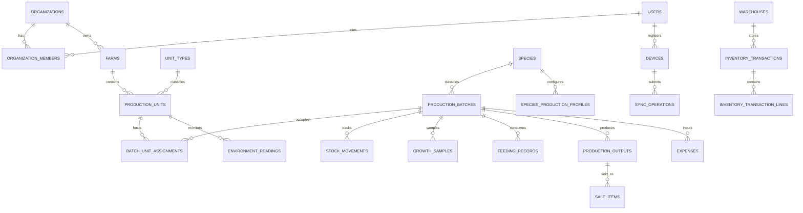

# TernakMatric — ERD dan Keputusan Domain

Dokumen ini menjelaskan relasi dan keputusan domain pada **baseline** [`001_ternakmatric_schema.sql`](001_ternakmatric_schema.sql). Tambahan yang hanya ada di migrasi—`individual_tags`, `vaccination_schedules`, `biosecurity_logs`—tercantum sebagai ekstensi di [`../docs/06-DATABASE-ERD.md`](../docs/06-DATABASE-ERD.md).

## 1. Tenant dan identitas

`users` adalah identitas global. `organizations` adalah tenant. `organization_members` menghubungkan user ke tenant. `member_roles` memberikan peran spesifik tenant. Satu user dapat menjadi anggota beberapa organisasi.

Kedua tabel identitas ini **sengaja tidak memakai RLS tenant**; akses dikendalikan lewat GRANT dan pengecekan membership/RBAC di backend.

## 2. Farm dan unit produksi

`organizations 1:N farms`; `farms 1:N production_units`.

Unit produksi dapat berupa kolam, kandang, cage, pasture, hive, atau enclosure lain. Kapasitas disimpan sebagai `capacity_value` + `capacity_unit` (`head`, `kg`, `m3`, dll.). Dimensi spesifik ikan adalah kunci opsional di `dimensions`; `volume_m3` turunan dipelihara aplikasi.

## 3. Species dan profil produksi

`species.organization_id IS NULL` berarti species sistem global. Nilai non-null berarti species custom milik tenant. `species.category` mencakup fish, crustacean, mollusk, poultry, mammal, reptile, insect, dan other.

`species_production_profiles` menyimpan parameter husbandry spesifik species/strain/sistem pada `parameters jsonb` berversi. Batch historis tetap memakai versi profilnya.

## 4. Batch dan okupansi unit

`production_units 1:N batch_unit_assignments`; `production_batches 1:N batch_unit_assignments`.

Satu batch dapat berpindah unit dari waktu ke waktu. Hanya satu assignment aktif per batch yang diizinkan; satu unit dapat menampung beberapa batch aktif. Kapasitas adalah invarian bisnis lintas baris yang divalidasi dalam transaksi dengan `SELECT ... FOR UPDATE` pada unit dan gabungan okupansi/biomassa seluruh assignment aktif.

## 5. Ledger produksi

`stock_movements` adalah ledger populasi yang otoritatif. `mortality_records`, `production_outputs`, dan `environment_readings` adalah catatan deskriptif/event yang harus menulis pergerakan stok terkait dalam transaksi yang sama bila berlaku.

Jenis pergerakan mencakup stok awal/tambahan, kelahiran, pembelian, mortalitas, cull, panen, pengumpulan telur, pengumpulan susu, transfer, penjualan, penyesuaian, dan reversal.

## 6. Pemantauan lingkungan

`environment_metrics` adalah katalog metrik global. `environment_readings` menyimpan pengukuran air, udara, tanah, kandang, dan pakan memakai `metric_id`, `metric_value`, dan `unit` eksplisit. Model yang sama mendukung DO/pH kolam dan NH3/kelembapan kandang unggas.

## 7. Inventory

`inventory_transactions` adalah header; `inventory_transaction_lines` berisi kuantitas produk, satuan, lot, biaya, dan referensi batch opsional. Pakai satuan kanonik dan transaksi posting yang immutable. Transfer harus memiliki efek keluar dan masuk dalam satu transaksi database.

`feeding_records` menghubungkan pencatatan pakan operasional ke produk dan opsional ke baris keluar inventory. Keluar inventory dan catatan pakan harus di-commit secara atomik.

## 8. Output dan keuangan

`production_outputs` mencatat daging, telur, susu, fry, cull, offspring, dan output lainnya. Penjualan merujuk output melalui `sale_items.production_output_id`. Biaya dapat dialokasikan ke batch atau farm. Simpan snapshot transaksi untuk biaya satuan dan harga jual; jangan menghitung ulang transaksi historis dari harga katalog terkini.

## 9. Sinkronisasi offline

Perangkat mengirim `sync_operations` dengan `client_operation_id` yang stabil, UUID entitas, jenis operasi, dan `base_version`. Server memproses tiap operasi secara idempoten. Jika versi dasar sudah usang, server membuat baris `sync_conflicts`, bukan menimpa keadaan server diam-diam.

Gunakan ledger yang dipegang server untuk stok, inventory, output, dan keuangan. `outbox_events` menyediakan change feed untuk respons sinkronisasi dan notifikasi.

## 10. Ringkasan ERD

