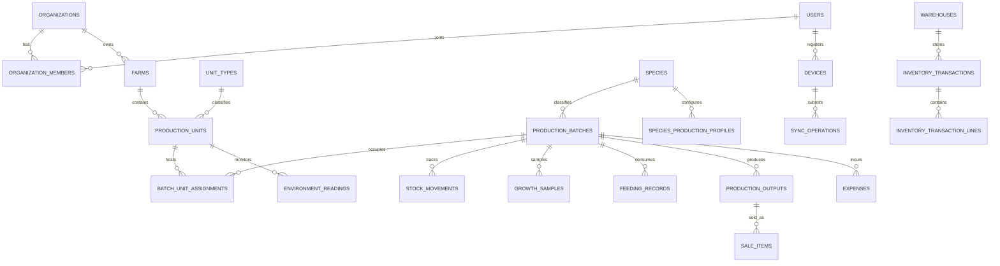

# TernakMatric ERD and Domain Decisions

## 1. Tenant and identity
`users` are global identities. `organizations` are tenants. `organization_members` connects users to tenants. `member_roles` assigns tenant-specific roles. A user can belong to multiple organizations.

## 2. Farm and production unit
`organizations 1:N farms`; `farms 1:N production_units`.
A production unit may be a pond, coop, pen, cage, pasture, hive, or another enclosure. Capacity is stored as `capacity_value` + `capacity_unit` (`head`, `kg`, `m3`, etc.). Fish-specific dimensions are optional keys in `dimensions`; derived `volume_m3` is application-maintained.

## 3. Species and production profiles
`species.organization_id IS NULL` means a global system species. A non-null organization means a tenant-owned custom species. `species.category` covers fish, crustacean, mollusk, poultry, mammal, reptile, insect, and other.
`species_production_profiles` capture species/strain/system-specific husbandry parameters in versioned `parameters jsonb`. Historical batches keep their profile version.

## 4. Batch and unit occupancy
`production_units 1:N batch_unit_assignments`; `production_batches 1:N batch_unit_assignments`.
A batch may move between units over time. Only one open/current assignment per batch is allowed; a unit may host multiple active batches. Capacity is a cross-row business invariant validated under transaction with `SELECT ... FOR UPDATE` on the unit and combined occupancy/biomass across all active assignments.

## 5. Production ledgers
`stock_movements` is the authoritative population ledger. `mortality_records`, `production_outputs`, and `environment_readings` are descriptive/event records that must write their corresponding movement in the same transaction where applicable.
Movement types cover initial/additional stock, birth, purchase, mortality, cull, harvest, egg collection, milk collection, transfer, sale, adjustment, and reversal.

## 6. Environment monitoring
`environment_metrics` is a global metric catalog. `environment_readings` stores water, air, soil, housing, and feed measurements using `metric_id`, `metric_value`, and explicit `unit`. The same model supports pond DO/pH and poultry house NH3/humidity.

## 7. Inventory
`inventory_transactions` is the header; `inventory_transaction_lines` contains product quantity, unit, lot, cost, and optional batch references. Use canonical units and immutable posted transactions. A transfer must have source and destination effects in one database transaction.
`feeding_records` links operational feeding to product and optionally to the inventory issue line. The inventory issue and feeding record must be committed atomically.

## 8. Output and finance
`production_outputs` records meat, eggs, milk, fry, culls, offspring, and other outputs. Sales reference outputs through `sale_items.production_output_id`. Expenses can be allocated to a batch or farm. Use transaction snapshots for unit cost and sale price; never recalculate historical transactions from current catalog prices.

## 9. Offline synchronization
Devices submit `sync_operations` with a stable `client_operation_id`, entity UUID, operation type, and `base_version`. The server processes each operation idempotently. If the base version is stale, create a `sync_conflicts` row rather than silently overwriting server state.
Use server-authoritative ledgers for stock, inventory, outputs, and finance. `outbox_events` provides the change feed for sync responses and notifications.

## 10. ERD overview

