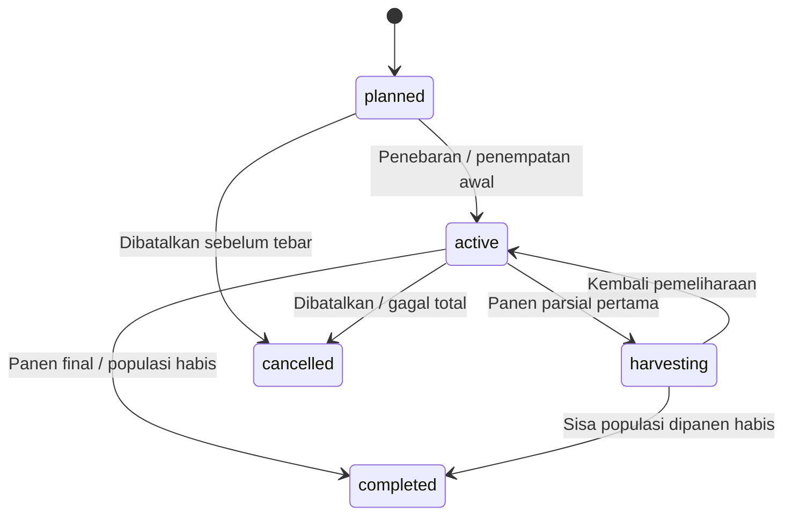

# 05 — Domain Model: TernakMatric

**Dokumen**: `TM-DOC-05` · **Status**: Baseline v1.0 · **Tanggal**: 2026-11-24

Model domain TernakMatric memisahkan batas tanggung jawab ke dalam 8 modul domain (`mod-*`) dan 3 crate fondasi (`shared-kernel`, `infra-db`, `infra-auth`), dengan **Organization** sebagai tenant boundary kanonik.

---

## 1. Peta Bounded Context & Modul

| Modul Crate | Tanggung Jawab Domain | Entitas Utama |
| --- | --- | --- |
| `mod-tenant` | Multi-tenant SaaS, keanggotaan staf, RBAC, multi-farm | `Organization`, `OrganizationMember`, `Role`, `Permission`, `Farm` |
| `mod-enclosure` | Kandang, kolam, cage, pasture, hive; dimensi & kapasitas | `UnitType`, `ProductionSystem`, `ProductionUnit` (Enclosure) |
| `mod-species` | Katalog spesies lintas kategori & profil produksi berversi | `Species`, `SpeciesProductionProfile`, `GrowthStage`, `FeedingGuideline` |
| `mod-production` | Siklus produksi (cohort/batch), penempatan unit, populasi, tag individu, pertumbuhan, output | `ProductionBatch`, `BatchUnitAssignment`, `StockMovement`, `PopulationBalance`, `IndividualTag`, `GrowthSample`, `ProductionOutput` |
| `mod-feeding` | Gudang, SKU pakan/ransum, konversi satuan, ledger stok pakan, konsumsi aktual | `Warehouse`, `FeedProduct`, `FeedUnitConversion`, `InventoryTransaction`, `InventoryBalance`, `FeedingRecord` |
| `mod-environment` | Pengukuran lingkungan kandang & kualitas air (manual & IoT-ready) | `EnvironmentMetric`, `EnvironmentReading` |
| `mod-health` | Jadwal vaksinasi, pengobatan, observasi penyakit, mortalitas, log biosecurity | `VaccinationSchedule`, `HealthRecord`, `MortalityRecord`, `BiosecurityLog` |
| `mod-finance` | Biaya operasional, penjualan output, HPP per kg hidup, profitabilitas, snapshot kalkulasi | `ExpenseCategory`, `Expense`, `Sale`, `SaleItem`, `CalculationRun` |
| `mod-calculation` | Engine rumus murni lintas spesies (tanpa DB/HTTP) | `CapacityCalc`, `PopulationCalc`, `GrowthCalc`, `BiomassCalc`, `FcrCalc`, `HarvestCalc`, `FinanceCalc` |

---

## 2. Konsep Inti Lintas Spesies

### 2.1 Enclosure (`production_units`)
Istilah **Enclosure** di domain merepresentasikan seluruh wadah/tempat pemeliharaan di tabel `production_units`:
- **Akuatik (`habitat = water`)**: kolam tanah, kolam terpal, kolam beton, fiber, tangki RAS, tambak. Memakai `dimensions` (`length_m`, `width_m`, `diameter_m`, `average_depth_m`), `area_m2`, dan `volume_m3`.
- **Terestrial & Lainnya (`land`, `cage`, `pasture`, `hive`, `other`)**: kandang broiler/layer, *battery cage*, kandang babi/kambing/sapi (`pen`), padang gembala (`pasture`), sarang lebah (`hive`), nampan serangga (`tray`). Memakai `area_m2`, `capacity_value`, dan `capacity_unit` (`head`, `kg`, `m2`, `tray`, `crate`, `colony`, `hive`).

### 2.2 Cohort / Batch (`production_batches`) & Assignment
- Satu **Batch/Cohort** merepresentasikan satu kelompok/siklus ternak dari satu `species_id` yang dikelola bersama (mis. 1.000 ekor nila, 5.000 ekor broiler, 50 ekor babi grower, atau 20 ekor sapi potong).
- Hubungan ke enclosure bersifat `Enclosure 1:N Batch` melalui `batch_unit_assignments`:
  - **Satu batch** hanya memiliki **maksimal satu assignment aktif** (`released_at IS NULL`) pada satu waktu.
  - **Satu enclosure** dapat menampung **banyak batch aktif** secara bersamaan (polikultur atau multi-cohort dalam satu kandang besar), dengan syarat total biomassa/okupansi gabungan tidak melebihi kapasitas enclosure.
- Pemindahan kandang/kolam menutup assignment lama (`released_at = now()`) dan membuka assignment baru dalam satu transaksi atomik.

### 2.3 Individual Tag (`individual_tags`)
Untuk komoditas bernilai tinggi per ekor (sapi, kambing/domba, induk babi, indukan ikan/reptil), `mod-production` menyediakan `IndividualTag` yang tertaut ke `production_batches`:
- Menyimpan `tag_code` (unik per organisasi), `tag_type` (`ear_tag`, `rfid`, `leg_band`, `microchip`, `tattoo`), `sex` (`male`, `female`, `unknown`), `birth_date`, `sire_tag_id`, `dam_tag_id`, `initial_weight_g`, dan `status` (`active`, `culled`, `deceased`, `sold`, `transferred`).
- Mutasi kematian/penjualan individu tetap menghasilkan `stock_movements` pada batch induknya agar saldo populasi tetap sinkron.

### 2.4 Species Profile Berversi (`species_production_profiles`)
- Master spesies dapat berupa baris sistem global (`is_system = true, organization_id IS NULL`) atau custom milik tenant (`is_system = false, organization_id = <org>`).
- Setiap batch mengikat `production_profile_id` pada versi tertentu (`version`, `valid_from`, `valid_until`). Perubahan parameter pada versi baru (kepadatan tebar, rentang suhu/pH/NH3, target ADG/SGR, atau panduan pakan) tidak pernah mengubah histori atau kontrak batch yang sedang berjalan.

### 2.5 Health, Vaccination & Biosecurity (`mod-health`)
- **`VaccinationSchedule`**: jadwal vaksin per batch/unit (nama vaksin, dosis, rute pemberian seperti `oral`/`injection`/`spray`/`water`, tanggal jatuh tempo, status `scheduled`/`completed`/`overdue`/`skipped`).
- **`HealthRecord`**: kejadian observasi gejala, dugaan penyakit, dan pengobatan aktual (termasuk masa henti obat/*withdrawal period* sebelum panen).
- **`MortalityRecord`**: catatan kematian/cull harian yang secara atomik menulis `stock_movements` pengurang populasi.
- **`BiosecurityLog`**: catatan sanitasi kandang/kolam, desinfeksi, karantina masuk, dan pemeriksaan lalu lintas kendaraan/pengunjung per farm atau enclosure.

---

## 3. State Lifecycle Batch & Sync Command

Seluruh aksi lapangan dari mobile offline dikirim sebagai *command* (`create` / `update` / `delete`) yang memuat `client_operation_id` (untuk idempotency) dan `base_version` (untuk deteksi konflik versi server).
