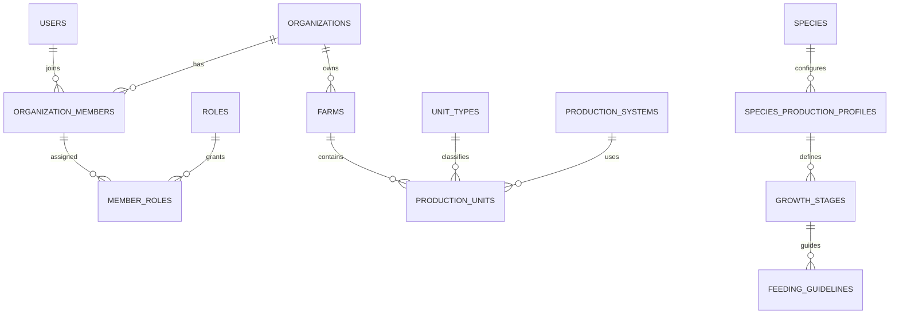
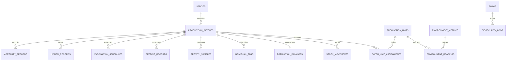
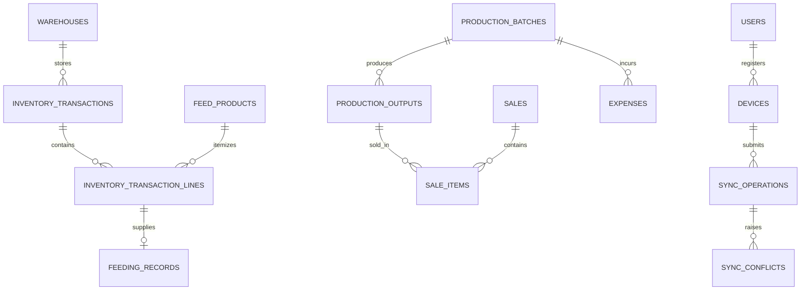

# 06 — Database ERD & Schema Blueprint: TernakMatric

**Dokumen**: `TM-DOC-06` · **Status**: Baseline v1.0 · **Tanggal**: 2026-11-24

Dokumen ini merangkum desain skema fisik PostgreSQL 16+ pada [`data/001_ternakmatric_schema.sql`](../data/001_ternakmatric_schema.sql) beserta perluasan modul `mod-production` (`individual_tags`) dan `mod-health` (`vaccination_schedules`, `biosecurity_logs`) yang diimplementasikan di `backend/migrations/`.

---

## 1. Prinsip Desain Database

1. **Primary Key UUID (`uuid`)** untuk mendukung pembuatan ID di perangkat mobile (*offline-first*).
2. **Tenant Boundary `organization_id`** pada seluruh tabel bisnis, dengan dua lapis isolasi:
   - **Composite Foreign Key** `(id, organization_id)` pada semua relasi antar-tabel tenant sehingga referensi lintas-organisasi ditolak oleh DB.
   - **PostgreSQL Row-Level Security (RLS)** aktif (`FORCE ROW LEVEL SECURITY`) dengan GUC `app.current_organization_id` yang diset via `SET LOCAL` di awal transaksi.
3. **Append-Only Ledgers**: `stock_movements`, `inventory_transaction_lines`, dan `audit_logs` dilindungi trigger `deny_ledger_mutation()` agar tidak dapat di-`UPDATE` maupun di-`DELETE`.
4. **Transaction-Maintained Projections**: `population_balances` dan `inventory_balances` diperbarui dalam transaksi yang sama dengan baris ledger disertai *row lock* (`SELECT ... FOR UPDATE`) agar saldo tidak pernah negatif.

---

## 2. Entity Relationship Diagram

### 2.1 Tenant, Farm, Enclosure & Species

### 2.2 Production, Tagging, Feeding, Environment & Health

### 2.3 Inventory, Output, Finance & Offline Sync

---

## 3. Daftar Migrasi SQLx (`backend/migrations/`)

| File Migrasi | Cakupan Tabel |
| --- | --- |
| `2026112401_init_identity_organizations.sql` | Fungsi trigger dasar, `users`, `organizations`, `plans`, `subscriptions`, `roles`, `permissions`, `role_permissions`, `organization_members`, `member_roles` |
| `2026112402_init_farm_enclosure_species.sql` | `unit_types`, `production_systems`, `farms`, `production_units`, `species`, `species_production_profiles`, `growth_stages`, `feeding_guidelines` |
| `2026112403_init_production_ledger.sql` | `production_batches`, `batch_unit_assignments`, `stock_movements`, `population_balances`, `individual_tags`, `growth_samples`, `production_outputs` |
| `2026112404_init_feeding_inventory.sql` | `warehouses`, `feed_products`, `feed_unit_conversions`, `inventory_transactions`, `inventory_transaction_lines`, `inventory_balances`, `feeding_records` |
| `2026112405_init_environment_health.sql` | `environment_metrics`, `environment_readings`, `vaccination_schedules`, `health_records`, `mortality_records`, `biosecurity_logs` |
| `2026112406_init_finance_calculation.sql` | `expense_categories`, `expenses`, `sales`, `sale_items`, `calculation_versions`, `calculation_runs`, `audit_logs` |
| `2026112407_init_offline_sync.sql` | `devices`, `sync_operations`, `sync_conflicts`, `outbox_events` |
| `2026112408_rls_triggers_hardening.sql` | Trigger cross-tenant, trigger *append-only ledger*, `set_updated_at`, dan kebijakan RLS seluruh tabel |
| `2026112409_seed_catalogs.sql` | Data referensi global: `unit_types`, `production_systems`, `species` (8 kategori), `environment_metrics`, `plans`, `expense_categories`, `calculation_versions` (termasuk `SGR` & `HPP_LIVE_WEIGHT`) |

Detail kontrak tiap kolom tersedia pada [Schema SQL](../data/001_ternakmatric_schema.sql) dan [Data Dictionary](../data/DATA_DICTIONARY.md).
