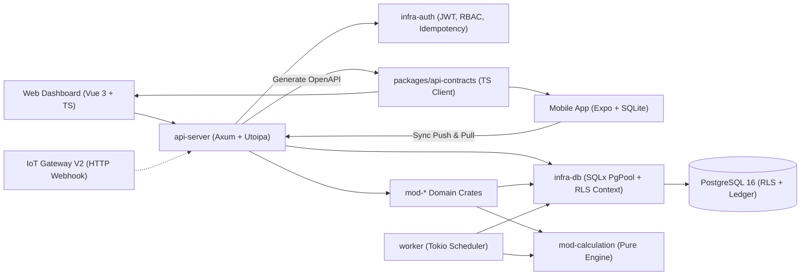

# 07 — System Architecture: TernakMatric

**Dokumen**: `TM-DOC-07` · **Status**: Baseline v1.0 · **Tanggal**: 2026-11-24

---

## 1. Pilihan Gaya Arsitektur: Modular Monolith di Rust

TernakMatric dibangun sebagai **Modular Monolith** menggunakan satu **Rust Cargo Workspace** (`backend/`). Pilihan ini menjaga batas domain tetap ketat antar-crate sambil mempertahankan kesederhanaan deployment (1 binary API server + 1 binary worker + 1 database PostgreSQL).



---

## 2. Struktur Backend Workspace & Ketergantungan Antar-Crate

Aturan arah ketergantungan (*dependency rule*):
1. `shared-kernel` dan `mod-calculation` **tidak boleh** bergantung pada `sqlx`, `axum`, atau crate I/O jaringan.
2. `infra-db` dan `infra-auth` hanya bergantung pada `shared-kernel` dan pustaka infrastruktur (`sqlx`, `axum`, `jsonwebtoken`).
3. Modul bisnis (`mod-tenant`, `mod-enclosure`, `mod-species`, `mod-production`, `mod-feeding`, `mod-environment`, `mod-health`, `mod-finance`) bergantung pada `shared-kernel`, `infra-db`, `infra-auth`, dan `mod-calculation` sesuai kebutuhan—tanpa akses silang tabel milik modul lain secara langsung tanpa kontrak yang jelas.
4. `bins/api-server` merangkai router Axum, state aplikasi, dan dokumen OpenAPI `utoipa` gabungan seluruh modul.
5. `bins/worker` menjalankan tugas latar belakang periodik:
   - **Daily Snapshot**: menghitung dan menyimpan `calculation_runs` harian (biomassa, FCR, ADG, SGR, HPP).
   - **Vaccination Reminder**: mendeteksi jadwal vaksin jatuh tempo (H-3, H-1, overdue) dan menerbitkan event notifikasi/outbox.
   - **Alert Engine**: mengevaluasi anomali mortalitas, stok pakan menipis, serta pembacaan lingkungan di luar rentang profil spesies.

---

## 3. Strategi Keamanan & Isolasi Multi-Tenant

Lihat [ADR 001](decisions/001-tenant-boundary.md):
1. Client mengirimkan JWT yang memuat `user_id`. Tenant aktif (`organization_id`) divalidasi terhadap tabel `organization_members` dengan status `active` serta izin RBAC dari `member_roles` + `role_permissions`.
2. Sebelum query bisnis dijalankan, `infra-db::OrganizationContext::begin_tx` mengeksekusi:
   ```sql
   SELECT set_config('app.current_organization_id', $1, true);
   ```
   (`SET LOCAL` di dalam transaksi agar aman untuk *connection pooling*).
3. Role PostgreSQL yang dipakai oleh aplikasi wajib bukan `superuser`, bukan owner tabel, dan tidak memiliki atribut `BYPASSRLS`.

---

## 4. Arsitektur Offline-First Mobile & Sinkronisasi

Lihat [ADR 002](decisions/002-offline-sync.md):
- **Client (`apps/mobile`)**:
  - Data master dan catatan operasional disimpan lokal di SQLite (`src/storage/`).
  - Mutasi offline dimasukkan ke tabel antrean lokal (`src/sync/`) sebagai command dengan `client_operation_id` (UUID v4 yang dibuat sekali di perangkat) dan `base_version`.
  - Layar resolusi konflik (`src/offline/`) menampilkan command berstatus `conflict` atau `rejected` beserta snapshot server.
- **Server (`infra-auth` + endpoint `/api/v1/sync/*`)**:
  - `POST /api/v1/sync/push` memproses setiap command secara idempoten dengan constraint unik `(organization_id, device_id, client_operation_id)`.
  - Jika `base_version` lebih kecil dari versi server saat ini, transaksi ditolak ke `sync_conflicts` tanpa menimpa data server.
  - Untuk ledger stok, inventory, output, dan keuangan, kebijakan `client_wins` dilarang oleh constraint database dan domain validator.
  - `GET /api/v1/sync/pull?cursor=<id>` mengembalikan delta perubahan dari `outbox_events`.

---

## 5. Kontrak API Otomatis (`packages/api-contracts`)

1. Setiap handler dan DTO di `crates/mod-*` menggunakan anotasi `utoipa::ToSchema` dan `#[utoipa::path(...)]`.
2. `api-server --export-openapi` mengekspor spesifikasi OpenAPI 3.1 ke `packages/api-contracts/openapi/ternakmatric.v1.json`.
3. Paket `@ternakmatric/api-contracts` menyediakan tipe TypeScript dan client HTTP terketik untuk `apps/web` dan `apps/mobile`.
