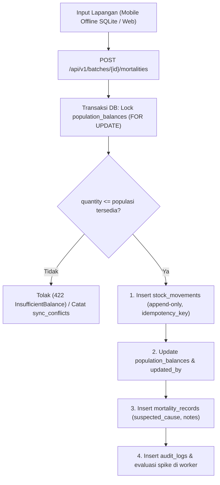

# 11 — Pencatatan Mortalitas, Kegagalan Siklus Panen & Strategi Pencegahan

**Dokumen**: `TM-DOC-11` · **Status**: Baseline v1.0 · **Tanggal**: 2026-11-25

Dokumen ini menjadi panduan operasional dan teknis untuk mencatat tingkat kematian (*mortality*), afkir (*cull*), dan kegagalan siklus panen (*cycle failure*) di **TernakMatric**, sekaligus mekanisme pencegahan dini berbasis modul kesehatan, lingkungan, kapasitas unit, pakan, dan biosecurity lintas spesies (`fish`, `crustacean`, `mollusk`, `poultry`, `mammal`, `reptile`, `insect`, `other`).

---

## 1. Taksonomi Kejadian: Kematian, Afkir, Panen Dini & Kegagalan Siklus

Agar analisis biologi dan keuangan tidak rancu, operator dan manajer wajib membedakan empat status kejadian berikut:

| Kejadian | Definisi Operasional | Representasi di TernakMatric | Dampak ke Populasi & Keuangan |
| --- | --- | --- | --- |
| **Mortalitas (`mortality`)** | Kematian ternak akibat penyakit, stres lingkungan, predator, atau penyebab alami | `mortality_records` + `stock_movements` (`movement_type = 'mortality'`, `quantity_delta < 0`) | Mengurangi `population_balances`; pakan yang terlanjur dimakan menaikkan *Economic FCR* dan *HPP per kg hidup* |
| **Afkir (`cull`)** | Eliminasi/pemisahan ternak kerdil, cacat, atau sakit berat untuk melindungi sisa cohort | `stock_movements` (`movement_type = 'cull'`, `quantity_delta < 0`), opsional output di `production_outputs` (`output_type = 'cull'`) | Mengurangi `population_balances`; bila bernilai jual tetap bisa masuk `sale_items` |
| **Panen Dini (`emergency_harvest`)** | Pemungutan hasil lebih cepat dari target untuk menyelamatkan biomassa saat krisis lingkungan/wabah | `production_outputs` (`meat`/`fry`) + `stock_movements` (`harvest`) dalam satu transaksi | Menyelamatkan sebagian pendapatan; menurunkan total tonase vs target rencana |
| **Gagal Siklus (`cycle_failure`)** | Penghentian total satu siklus batch sebelum layak panen (kematian massal, wabah tak terkendali, kerusakan enclosure) | `production_batches.status = 'cancelled'` + sisa mortalitas dicatat tuntas + alasan di `notes` & `audit_logs` | Batch ditutup untuk input operasional baru; seluruh biaya tercatat sebagai kerugian siklus untuk evaluasi *post-mortem* |

> [!IMPORTANT]
> Output produksi harian non-daging seperti `egg_collection` dan `milk_collection` tidak pernah mengurangi saldo populasi ekor hidup di `population_balances`.

---

## 2. Alur Pencatatan Kematian & Kegagalan di Sistem

### 2.1 Data Wajib Saat Mencatat Kematian
Melalui endpoint `POST /api/v1/batches/{id}/mortalities` (atau antrean offline mobile):
1. `quantity`: jumlah ekor mati (`> 0`).
2. `occurred_at`: waktu kejadian aktual di lapangan (`timestamptz`), penting untuk analisis korelasi dengan cuaca/pemberian pakan/bacaan lingkungan.
3. `suspected_cause`: kategori dugaan penyebab yang konsisten (misal: `do_drop`, `ammonia_spike`, `heat_stress`, `respiratory_disease`, `viral_outbreak`, `predator`, `cannibalism`, `handling_stress`, `seed_weakness`, `unknown`).
4. `notes`: gejala klinis, perubahan warna/insang/kotoran, atau kondisi kandang/air saat ditemukan.
5. `idempotency_key`: UUID unik dari perangkat agar retry jaringan tidak menggandakan pengurangan populasi.

### 2.2 Aturan Integritas, Koreksi & Tag Individu
- **Validasi Populasi**: Sistem mengunci baris `population_balances` (`SELECT ... FOR UPDATE`) dan menolak input jika `mortality > populasi tersedia`.
- **Append-Only & Reversal**: `stock_movements` dilindungi trigger `deny_ledger_mutation()`. Jika operator salah mengetik angka (misal `100` padahal `10`), data lama **tidak boleh** dihapus/diubah; koreksi dilakukan dengan mencatat `stock_movements` bertipe `reversal` (mereferensikan `reversal_of`) atau `adjustment` yang diaudit di `audit_logs`.
- **Ternak Bertag Individu (`individual_tags`)**: Untuk sapi, kambing/domba, induk babi, atau indukan bernilai tinggi, selain mencatat mortalitas pada batch, perbarui status tag individu terkait menjadi `deceased` atau `culled` agar riwayat genetik (`sire_tag_id`, `dam_tag_id`) tetap terjaga.
- **Menutup Siklus Gagal**: Jika tingkat kematian mencapai ambang gagal panen atau siklus dihentikan paksa:
  1. Catat seluruh sisa mortalitas/cull atau hasil penyelamatan (`production_outputs`).
  2. Tutup assignment enclosure (`batch_unit_assignments.released_at`) agar unit dapat disanitasi dan dipakai kembali.
  3. Ubah status batch menjadi `cancelled` via `PATCH /api/v1/batches/{id}` disertai ringkasan penyebab kegagalan pada `notes`.

---

## 3. Perhitungan Tingkat Kematian & Dampak Finansial (`mod-calculation`)

Semua metrik dihitung deterministik di `mod-calculation` dengan versi formula eksplisit:

### 3.1 Mortality Rate (MR) & Survival Rate (SR)
- **Mortality Rate Kumulatif (%)**:
  $$\text{MR (\%)} = \frac{\text{Total Mortality}}{\text{Total Stocked}} \times 100$$
  di mana $\text{Total Stocked} = P_0 + S + B + \text{Pur} + T_{\text{in}}$.
- **Mortality Rate Harian (%)**:
  $$\text{Daily MR (\%)} = \frac{\text{Mortality Hari Ini}}{\text{Populasi Hidup Awal Hari}} \times 100$$
  Metrik ini dipakai untuk mendeteksi lonjakan akut (*acute mortality spike*) sebelum mortalitas kumulatif terlihat tinggi.
- **Survival Rate (`SurvivalMode`)**:
  - `CumulativeAccounted`: $\frac{\text{Alive} + \text{Harvested} + \text{TransferOut}}{\text{Total Stocked}} \times 100$ — mencegah panen parsial terbaca seolah-olah ternak mati.
  - `NetRemainingStock`: $\frac{\text{Alive}}{\text{Total Stocked} - \text{Harvested} - \text{TransferOut}} \times 100$ — menilai ketahanan stok tersisa.

### 3.2 Dampak ke FCR dan HPP per Kg Hidup
- **Biological FCR** vs **Economic FCR**: Saat kematian terjadi di akhir siklus (ketika bobot individu sudah besar dan pakan yang dihabiskan banyak), selisih antara *Biological FCR* dan *Economic FCR* akan melebar tajam. Ini indikator langsung kerugian pakan akibat mortalitas lanjut.
- **Kenaikan HPP per Kg Hidup**:
  $$\text{HPP per kg} = \frac{\text{Biaya Bibit} + \text{Biaya Pakan} + \text{Kesehatan} + \text{Operasional}}{\text{Total Kg Hidup Dihasilkan}}$$
  Mortalitas menurunkan penyebut (*Total Kg Hidup*) sementara pembilang (*Total Biaya*) tetap bertambah, sehingga HPP/kg naik dan margin laba menyusut atau berbalik rugi.

---

## 4. Strategi Pencegahan Kegagalan & Mortalitas di TernakMatric

Pencegahan dilakukan secara berlapis dari sebelum tebar/masuk kandang hingga menjelang panen, memanfaatkan fitur lintas modul:

### 4.1 Pencegahan Pra-Siklus (Sebelum Batch Aktif)
1. **Validasi Kapasitas Multi-Batch (`mod-enclosure`)**:
   - Selalu evaluasi okupansi gabungan semua batch aktif dalam satu unit (`POST /api/v1/enclosures/{id}/calculate-capacity`) sebelum penebaran atau transfer. *Overstocking* adalah pemicu utama stres kronis, kanibalisme, penurunan DO (air), dan penumpukan amonia.
2. **Sanitasi & Istirahat Unit (`mod-health` · `biosecurity_logs`)**:
   - Terapkan pengosongan & pengeringan/disinfeksi enclosure antar-siklus (*all-in / all-out* bila memungkinkan), lalu wajibkan pencatatan `biosecurity_logs` (`activity_type = 'disinfection'`, `passed = true`) sebelum batch baru ditempatkan.
3. **Karantina & Aklimatisasi Stok Masuk**:
   - Catat penerimaan bibit/bakalan dan observasi awal (`health_records` tipe `observation`) selama fase adaptasi untuk mencegah pembawa penyakit masuk ke populasi lama.

### 4.2 Pencegahan Selama Siklus Berjalan (Monitoring Harian)
1. **Monitoring Lingkungan Proaktif (`mod-environment`)**:
   - Jangan menunggu kematian muncul. Catat parameter kunci secara rutin (manual via mobile atau webhook IoT di V2) dan bandingkan dengan batas aman pada `species_production_profiles.parameters`:
     - **Akuakultur (`fish`, `crustacean`)**: `WATER_TEMP`, `DO` (oksigen terlarut), `PH`, `AMMONIA_WATER`, `NITRITE`, `SALINITY`.
     - **Unggas & Mamalia (`poultry`, `mammal`)**: `AIR_TEMP`, `HUMIDITY`, `NH3_AIR` (amonia kandang), `CO2`, `LITTER_MOISTURE`.
     - **Serangga & Lahan (`insect`, `pasture`)**: `FEED_MOISTURE`, `SOIL_MOISTURE`, `AIR_TEMP`.
2. **Kepatuhan Vaksinasi & Pengobatan (`mod-health`)**:
   - Buat seluruh jadwal vaksin sejak awal siklus di `vaccination_schedules` (`POST /api/v1/batches/{id}/vaccinations`).
   - Background `worker` otomatis menandai jadwal lewat waktu menjadi `overdue` dan menerbitkan alert ke `outbox_events`.
   - Catat pengobatan di `health_records` beserta `withdrawal_days` agar panen tidak melanggar masa henti obat.
3. **Deteksi Dini Lewat Nafsu Makan & Pertumbuhan (`mod-feeding` + `mod-production`)**:
   - Penurunan konsumsi pakan harian (*feeding variance* negatif dibanding `feeding_guidelines`) dan melambatnya `ADG` / `SGR` pada `growth_samples` sering muncul **1–3 hari lebih awal** sebelum lonjakan kematian.
   - Pastikan pakan di gudang (`warehouses` / `inventory_transaction_lines`) dipantau `expiry_date` dan `FEED_MOISTURE`-nya untuk mencegah keracunan pakan berjamur/mikotoksin.
4. **Kontrol Biosecurity Rutin (`biosecurity_logs`)**:
   - Dokumentasikan aktivitas `footbath`, `vehicle_wash`, `visitor_entry`, `pest_control`, dan `equipment_sanitation` per farm/unit untuk memutus rantai penularan silang antar-kandang/kolam.

---

## 5. SOP Eskalasi & Matriks Tindakan Cepat

Sesuai prinsip desain TernakMatric ([ADR 003](decisions/003-calculation-engine.md)), angka ambang (*threshold*) batas kematian dan batas lingkungan **tidak di-hardcode universal** melainkan dikonfigurasi per spesies, strain, fase umur, dan sistem produksi pada `species_production_profiles.parameters`.

| Level Status | Kondisi Pemicu (Berdasarkan Profil Spesies) | Tindakan Wajib Operator & Farm Manager |
| --- | --- | --- |
| **Normal** | Mortalitas harian & parameter lingkungan di dalam rentang target profil; jadwal vaksin tepat waktu | Lanjutkan pencatatan pakan, sampling rutin, dan cek biosecurity harian. |
| **Waspada** | Kenaikan mortalitas harian di atas baseline normal, nafsu makan turun, atau bacaan lingkungan mendekati ambang batas | 1. Ukur ulang parameter lingkungan kunci (DO/amonia/suhu/NH3). 2. Lakukan perbaikan sirkulasi/aerasi/ventilasi atau manajemen litter/air. 3. Catat `health_records` (`observation`) dan evaluasi dosis pakan. |
| **Krisis** | Lonjakan mortalitas akut (*spike*), gejala penyakit menular teramati, atau parameter lingkungan di zona bahaya | 1. Isolasi/karantina unit (`biosecurity_logs`), batasi lalu lintas staf antar-unit. 2. Hentikan/kurangi pakan sementara sesuai panduan spesies. 3. Catat `disease_suspected` + ambil sampel nekropsi/lab dengan dokter hewan/penyuluh. 4. Pertimbangkan panen darurat (`emergency_harvest`) bila ukuran sudah ekonomis & bebas masa *withdrawal* obat. |
| **Gagal Siklus** | Mortalitas kumulatif melewati batas kelayakan biologis/finansial atau wabah tak terbendung | 1. Eksekusi penghentian siklus, catat seluruh sisa populasi keluar (`mortality`/`cull`) + pemusnahan bioaman. 2. Lakukan disinfeksi menyeluruh (`biosecurity_logs`) & masa istirahat unit (*down-time*). 3. Ubah status batch ke `cancelled` dan lakukan evaluasi *post-mortem* atas data lingkungan, pakan, dan bibit sebelum siklus berikutnya dimulai. |

---

## 6. Evaluasi Pasca-Siklus (*Post-Mortem* Berbasis Data)

Setiap siklus yang mengalami kematian tinggi atau gagal panen wajib ditinjau ulang memakai data historis yang tidak pernah tertimpa (*immutable*):
1. **Audit Trail (`GET /api/v1/audit-logs`)**: lacak kronologi perubahan status batch, mutasi stok, dan aktor pencatat (`created_by`, `updated_by`, `occurred_at`).
2. **Korelasi Lingkungan vs Mortalitas**: overlay grafik `environment_readings` terhadap `mortality_records` pada rentang tanggal puncak kematian.
3. **Evaluasi Sumber Bibit & Lot Pakan**: bandingkan performa batch pada `species_production_profiles` dan `lot_code` pakan yang sama di enclosure berbeda untuk membedakan masalah lokasi (*unit-specific*) vs masalah input (bibit/pakan).
4. **Perbaikan Profil Berversi**: jika penyebabnya adalah kepadatan terlalu tinggi atau jadwal vaksin kurang tepat, terbitkan **versi baru** `species_production_profiles` dan `vaccination_schedules` template agar siklus berikutnya terlindungi tanpa mengubah histori siklus lama.
