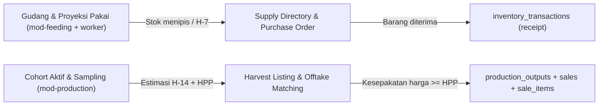

# 12 — Masalah Penjualan Panen & Suplai Pakan/Vitamin (Supply & Market Linkage)

**Dokumen**: `TM-DOC-12` · **Status**: Product & Solution Proposal v1.0 · **Tanggal**: 2026-11-25

Dokumen ini mendefinisikan dua masalah kritis di hulu dan hilir usaha petani/peternak — **sulitnya menjual hasil panen dengan harga layak** serta **sulitnya menemukan suplai pakan, ransum, vitamin, dan obat yang tepat** — beserta solusi berbasis data yang sudah tersedia di fondasi **TernakMatric** saat ini dan peta pengembangan modul ekosistem (**V1/V2**).

---

## 1. Definisi Masalah Lapangan (`PS-09` & `PS-10`)

| ID | Masalah di Lapangan | Dampak Nyata bagi Peternak / Pembudidaya |
| --- | --- | --- |
| **PS-09** | **Sulit menjual hasil panen** (akses pembeli terbatas, informasi panen baru dicari saat sudah siap angkut, negosiasi harga tanpa data) | 1. **Overfeeding & FCR bengkak**: ternak siap panen tertahan di kandang/kolam menunggu pembeli sehingga tetap menghabiskan pakan tanpa pertambahan bobot yang efisien. 2. **Posisi tawar lemah**: panen mendadak membuat peternak bergantung pada satu-dua tengkulak. 3. **Jual di bawah titik impas**: tanpa tahu HPP per kg hidup, peternak sering menerima harga yang ternyata rugi. |
| **PS-10** | **Sulit menemukan suplai pakan, vitamin & obat** (stok mendadak habis, sulit cari pemasok terdekat yang terpercaya, harga eceran tinggi) | 1. **Stres & perlambatan pertumbuhan**: kehabisan stok memaksa ganti merek/jenis pakan mendadak sehingga menurunkan nafsu makan dan ADG/SGR. 2. **Keterlambatan vitamin/vaksin**: meningkatkan risiko penyakit dan mortalitas (lihat [DOC-11](11-MORTALITY-FAILURE-PREVENTION.md)). 3. **Biaya input tinggi**: pembelian eceran mendadak tanpa perencanaan membuat biaya pakan (60–75% total biaya) tidak efisien. |

---

## 2. Solusi yang Sudah Bisa Dipakai dari Fondasi TernakMatric Saat Ini

Sebelum membangun fitur *marketplace* penuh, sistem inti TernakMatric yang ada saat ini sudah memberi fondasi data untuk memperbaiki posisi tawar penjualan dan perencanaan suplai:

### 2.1 Untuk Masalah Penjualan Panen (`PS-09`)
1. **Tahu HPP Nyata Sebelum Negosiasi (`mod-finance` + `mod-calculation`)**:
   - Endpoint `GET /api/v1/batches/{id}/financial-summary` menghitung **HPP per kg hidup** (`HPP_LIVE_WEIGHT`) dari gabungan biaya bibit, pakan, kesehatan/vaksin, dan operasional. Peternak memiliki angka batas bawah harga jual yang objektif.
2. **Proyeksi Panen Lebih Awal (`harvest_forecast`)**:
   - Berdasarkan populasi (`population_balances`), `ABW`, dan laju pertumbuhan (`ADG`/`SGR`) dari `growth_samples`, peternak dapat memperkirakan tanggal panen, estimasi tonase, dan kisaran ukuran (`grade`) sejak **7–14 hari sebelumnya**, sehingga pemasaran tidak dimulai saat panen sudah mendesak.
3. **Bukti Kualitas & Kepatuhan untuk Pembeli B2B (`mod-health` + `mod-environment`)**:
   - Riwayat `vaccination_schedules`, bebas masa *withdrawal* obat (`health_records.withdrawal_days`), serta catatan `biosecurity_logs` menjadi nilai tambah saat menawarkan hasil panen ke rumah potong, koperasi, restoran/HORECA, atau *offtaker* industri.

### 2.2 Untuk Masalah Suplai Pakan, Ransum & Vitamin (`PS-10`)
1. **Kontrol Stok & Tanggal Kedaluwarsa (`mod-feeding`)**:
   - `warehouses`, `inventory_balances`, `lot_code`, dan `expiry_date` membantu memantau sisa pakan/suplemen secara akurat serta mencegah kerugian akibat pakan/vitamin kedaluwarsa atau berjamur.
2. **Evaluasi Efisiensi Biaya Pakan Nyata (`FCR` & Biaya/Kg Gain)**:
   - Dengan menghubungkan `feed_products` ke `feeding_records` dan `growth_samples`, peternak dapat membandingkan performa FCR dan HPP antar-merek atau antar-supplier, bukan hanya memilih harga per sak termurah.

---

## 3. Rancangan Ekspansi Modul: Supply & Market Linkage (Roadmap V1 → V2)

> [!NOTE]
> Bagian berikut adalah rancangan pengembangan modul ekosistem lanjutan di atas schema inti TernakMatric saat ini (belum diimplementasikan di crate backend V0/MVP).

### 3.1 Solusi Hulu — Supply Network & Procurement (`PS-10`)
1. **Katalog Pemasok Terkurasi (`suppliers` & `supplier_catalog_items`)**:
   - Direktori supplier terverifikasi untuk pakan ikan/unggas/mamalia, hijauan/silase, premix, vitamin, probiotik, desinfektan, dan vaksin.
   - Menyimpan kategori input, spesifikasi nutrisi, satuan/kemasan, *minimum order quantity* (MOQ), harga indikatif, dan cakupan wilayah pengiriman (*service area*).
2. **Peringatan *Safety Stock* & Rekomendasi Order (`bins/worker`)**:
   - Menghitung laju konsumsi aktual 7 hari terakhir + proyeksi kebutuhan fase berikutnya dari `feeding_guidelines`.
   - Saat sisa stok `inventory_balances` menyentuh ambang *lead time* pengiriman (mis. cukup untuk < 5–7 hari) atau jadwal `vaccination_schedules` H-7 belum memiliki stok vaksin/vitamin, `worker` menerbitkan pengingat *restock*.
3. **Purchase Request / Order & Pembelian Kolektif (*Group Buying*)**:
   - Pembuatan PO dari aplikasi langsung ke supplier; saat barang tiba di kandang/kolam, konfirmasi penerimaan otomatis menulis `inventory_transactions` (`receipt`) dan `expenses`.
   - **Agregasi Kelompok Peternak**: beberapa peternak di area yang sama dapat menggabungkan kebutuhan pakan/vitamin dalam satu jadwal pengiriman untuk menekan ongkos kirim dan mendapatkan harga grosir.

### 3.2 Solusi Hilir — Harvest Market & Offtake Linkage (`PS-09`)
1. **Direktori Pembeli & Kontrak Offtake (`buyers` & `offtake_offers`)**:
   - Pencatatan jaringan pembeli terstruktur: pengepul, pasar lokal, koperasi, rumah potong hewan/unggas (RPH/RPA), pengolah hasil perikanan, dan HORECA, lengkap dengan preferensi spesies, ukuran/`grade`, serta syarat pembayaran.
2. **Publikasi Estimasi Panen Sebelum Jatuh Tempo (`harvest_listings`)**:
   - Dari batch berstatus `active` atau `harvesting`, peternak dapat memublikasikan jadwal ketersediaan panen (spesies, estimasi tonase, estimasi `ABW`/grade, lokasi kecamatan/kabupaten, rentang tanggal panen, serta harga penawaran minimum berbasis HPP).
   - Mendukung **panen parsial** maupun **panen terjadwal** agar pembeli bisa melakukan *booking* kuota sebelum ternak masuk fase *overgrown*.
3. **Batch Traceability Card & Pencatatan Penjualan Otomatis**:
   - Pembeli dapat melihat ringkasan kesiapan batch (usia siklus, bebas masa henti obat, kepatuhan vaksinasi, dan kualitas lingkungan ringkas) tanpa membuka rahasia finansial internal organisasi.
   - Ketika panen diambil pembeli, transaksi tercatat sekaligus di `production_outputs`, `stock_movements`, `sales`, dan `sale_items`.

---

## 4. Rencana Implementasi Bertahap

| Tahap | Fokus Fitur | Tujuan Terukur |
| --- | --- | --- |
| **MVP+ (Data Internal)** | Proyeksi kebutuhan pakan 7 hari, alert stok minimum gudang, dashboard HPP/kg + estimasi tanggal panen H-14 | Tidak ada keterlambatan order pakan/vaksin karena lupa cek gudang; peternak selalu tahu harga impas sebelum menjual |
| **V1 (Direktori & Pencatatan Terhubung)** | Buku alamat Supplier & Buyer per organisasi, riwayat harga beli per supplier, Purchase Order → Receipt otomatis, serta pencatatan kontrak/order pembeli | Perbandingan biaya & kualitas antar-supplier terukur; transaksi jual-beli lebih tertib tanpa catat ulang |
| **V2 (Ekosistem Marketplace & Group Buying)** | Pencarian supplier pakan/vitamin lintas wilayah berbasis radius, *pre-harvest listing* ke jaringan *offtaker* terverifikasi, dan agregasi pembelian kelompok peternak | Memperpendek rantai pasok input dan memberi akses pembeli alternatif di luar tengkulak tunggal |

---

## 5. Hipotesis yang Perlu Divalidasi pada Pilot

- **H4**: Publikasi estimasi panen H-14 beserta target ukuran (`ABW`) membantu peternak mengamankan pembeli lebih awal sehingga mengurangi hari pemeliharaan berlebih (*overfeeding*) dan menjaga harga jual di atas HPP.
- **H5**: Notifikasi *reorder point* berbasis konsumsi aktual + direktori supplier terverifikasi menurunkan frekuensi kehabisan pakan/vitamin mendadak dan mencegah pergantian merek pakan darurat di tengah siklus.
