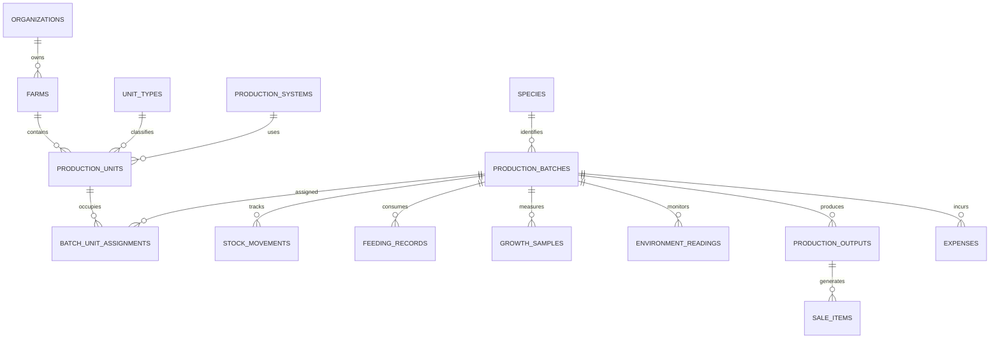
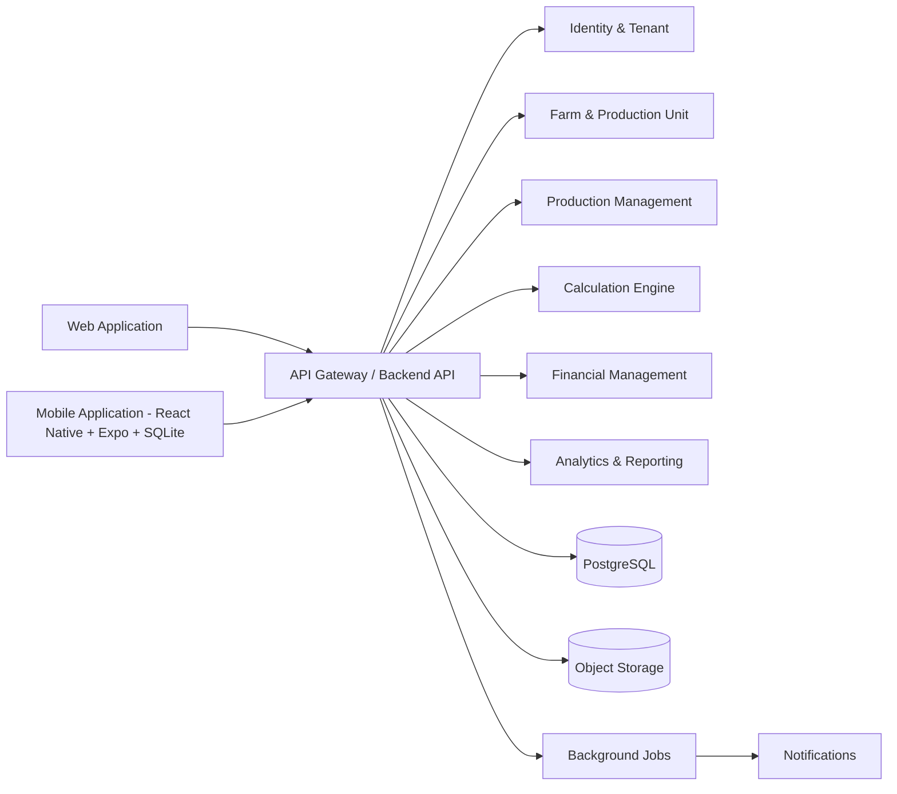

# note-2 — Product Requirements Document

> Catatan perjalanan desain. Versi terawat: [../02-PRODUCT-REQUIREMENTS.md](../02-PRODUCT-REQUIREMENTS.md). Indeks: [../README.md](../README.md).

Kita tetapkan TernakMatric sebagai produk **SaaS Multi-Tenant Animal Production Management Platform** yang mendukung ikan, unggas, babi, kambing/domba, sapi/kerbau, kelinci, crustacean, mollusk, serangga, dan spesies ternak lainnya, berbagai skala usaha, serta akses melalui web maupun mobile.

Ada satu keputusan arsitektur yang penting: meskipun TernakMatric mendukung banyak spesies, parameter produksi tidak boleh disamaratakan. Lele, nila, gurame, dan patin (fish) memiliki karakteristik berbeda; demikian pula ayam broiler dan layer (poultry), babi dan sapi perah (mammal), udang (crustacean), kerang (mollusk), ular (reptile), serta jangkrik dan maggot (insect). Karena itu, TernakMatric memakai konfigurasi produksi per spesies dan sistem produksi melalui `species_production_profiles` yang berversi — bukan angka universal yang di-hardcode.

Di bawah ini adalah dokumen fondasi produk versi 1.0 yang bisa menjadi acuan Product, UI/UX, Backend, Frontend, QA, dan Database Engineering.

## TernakMatric — Product Requirements Document

Product definition v1.0

SaaS

### TernakMatric

**Smart Animal Production Management System**

Platform digital untuk mengelola operasional produksi ternak — ikan di kolam, unggas dan mamalia di kandang, crustacean/mollusk di tambak atau rak, reptil, serta insect di media khusus — memonitor pertumbuhan, menghitung kebutuhan pakan, mengestimasi daging/telur/susu/fry, dan menganalisis profitabilitas.

| Informasi        | Keputusan                                                                    |
| ---------------- | ---------------------------------------------------------------------------- |
| Product type     | B2B SaaS                                                                     |
| Business model   | Multi-tenant                                                                 |
| Target market    | Semua skala dan jenis peternakan                                             |
| Species          | fish, crustacean, mollusk, poultry, mammal, reptile, insect, other           |
| Platform         | Web + Mobile                                                                 |
| Monitoring       | Manual dahulu, IoT kemudian                                                  |
| Database         | PostgreSQL                                                                   |
| Architecture     | Modular Monolith                                                             |
| Release strategy | MVP → V1 → V2                                                                |

Status: Draft untuk validasi Product Discovery · Dokumen: FM-PRD-001

## 1. Product Vision

**Vision**

Menjadi platform manajemen produksi ternak yang membantu peternak dari semua kategori — fish | crustacean | mollusk | poultry | mammal | reptile | insect | other — mengelola operasional, meningkatkan efisiensi produksi, dan mengambil keputusan berdasarkan data.

**Mission**

1. Digitalisasi pencatatan kegiatan produksi ternak.
2. Menyediakan perhitungan kapasitas unit produksi dan kebutuhan produksi per spesies.
3. Memantau pertumbuhan serta tingkat kelangsungan hidup semua spesies.
4. Membantu memperkirakan output: daging, telur, susu, fry, dan offspring.
5. Memberikan transparansi biaya dan keuntungan.
6. Membantu peternak mengelola beberapa unit produksi (kolam, kandang, cage, hive) dan lokasi dalam satu sistem.

### Value proposition / persona

| Pengguna                         | Nilai yang diberikan                                      |
| -------------------------------- | --------------------------------------------------------- |
| Peternak kecil                   | Pencatatan mudah dan kalkulasi otomatis                   |
| Peternak ikan / crustacean       | Kapasitas kolam/tambak, kualitas air, FCR, dan estimasi fry |
| Peternak unggas                  | Populasi kandang, konsumsi ransum, egg rate, dan mortalitas |
| Peternak babi                    | Pencatatan kelahiran, pakan, bobot, dan biaya per batch   |
| Peternak kambing/domba & sapi    | Kelahiran, pembelian, susu, weight gain, dan kesehatan    |
| Peternak kelinci, reptil, insect | Profil spesies custom dan pencatatan output khusus        |
| Peternak menengah                | Monitoring banyak unit produksi dan batch                 |
| Peternakan besar                 | Pengawasan operasional dan laporan lintas kategori        |
| Farm manager                     | Monitoring performa tim dan produksi                      |
| Business owner                   | Analisis biaya, omzet, dan profit                         |

## 2. Problem Statements

TernakMatric harus menyelesaikan masalah operasional yang nyata, bukan sekadar menyediakan fitur.

| ID    | Problem statement                                              | Dampak bisnis                       | Solusi TernakMatric          |
| ----- | -------------------------------------------------------------- | ----------------------------------- | ---------------------------- |
| PS-01 | Peternak kesulitan menghitung kapasitas kolam/kandang/cage/hive | Risiko overstocking                 | Unit capacity calculator     |
| PS-02 | Data stok awal, kelahiran, pembelian, dan kematian tidak konsisten | Populasi aktual tidak diketahui   | Stock movement tracking      |
| PS-03 | Penggunaan pakan/ransum tidak terukur                           | Pemborosan biaya                    | Feeding management           |
| PS-04 | Pertumbuhan ternak jarang diukur                                | Waktu panen sulit diprediksi        | Growth monitoring            |
| PS-05 | Kondisi air, udara, tanah, dan kandang tidak terdokumentasi     | Risiko kesehatan ternak             | Environment readings         |
| PS-06 | Hasil panen, telur, dan susu sulit diperkirakan                 | Perencanaan penjualan tidak optimal | Output forecasting           |
| PS-07 | Biaya operasional tersebar di berbagai catatan                  | Profit sulit dihitung               | Financial management         |
| PS-08 | Banyak unit produksi sulit dipantau secara bersamaan            | Inefisiensi operasional             | Farm dashboard               |

### Hipotesis produk

Kita memiliki beberapa hipotesis yang harus divalidasi kepada calon pengguna:

- H1: Peternak membutuhkan satu tempat untuk mencatat seluruh aktivitas produksi ternak.
- H2: Perhitungan otomatis akan mengurangi kesalahan pencatatan dan estimasi.
- H3: Data pertumbuhan dan pakan dapat membantu menentukan waktu panen, koleksi telur, atau susu.
- H4: Laporan biaya per batch dapat membantu mengetahui profitabilitas sebenarnya.
- H5: Peternak bersedia menggunakan aplikasi secara rutin jika input harian cukup sederhana.

Hipotesis ini belum boleh dianggap sebagai fakta pasar. Kita perlu melakukan wawancara dan uji coba lapangan.

## 3. Product Scope dan Modul

Saya membagi produk menjadi tiga kelompok besar.

**A. Core Production Management**

MVP

- Farm management
- Production unit management (unit types, production systems, kapasitas)
- Species catalog & `species_production_profiles`
- Production batch & `batch_unit_assignments`
- Stock movement & population balance
- Feeding records
- Growth & health monitoring
- Environment readings
- Production outputs (daging, telur, susu, fry, offspring)

**B. Business Intelligence**

V1

- Output prediction (daging, telur, susu, fry)
- FCR, weight gain, egg rate, dan milk yield analysis
- Survival rate & mortality analysis
- Financial reports
- Multi-farm analytics
- Operational reports

**C. Smart Animal Production**

V2

- IoT integration (air, udara, tanah, kandang)
- Automatic environment monitoring
- Sensor alerts
- Automated feeding integration
- Advanced predictive analytics
- AI-assisted recommendations

Catatan: environment readings manual tetap masuk MVP sebagai fitur dasar, tetapi integrasi sensor otomatis masuk V2.

## 4. User Roles dan Permission

Karena modelnya SaaS multi-tenant, kita perlu memisahkan identitas pengguna, organisasi, dan akses terhadap sumber daya.

| Role                 | Hak akses                             |
| -------------------- | ------------------------------------- |
| Platform Super Admin | Mengelola seluruh tenant SaaS         |
| Organization Owner   | Mengelola organisasi dan subscription |
| Organization Admin   | Mengelola operasional dan anggota     |
| Farm Manager         | Mengelola lokasi dan unit produksi    |
| Farm Operator        | Mencatat aktivitas produksi ternak    |
| Finance Staff        | Mengelola biaya dan penjualan         |
| Viewer               | Melihat dashboard dan laporan         |

Satu user bisa menjadi anggota lebih dari satu organisasi, dengan role yang berbeda di masing-masing organisasi.

Contoh:

- User A menjadi Owner di Organization 1.
- User A menjadi Viewer di Organization 2.
- User B menjadi Farm Manager di Organization 1.

Ini alasan kita tidak boleh menyimpan `role` langsung di tabel `users` sebagai satu role global.

## 5. User Stories

Berikut backlog awal yang bisa langsung digunakan untuk perencanaan sprint.

| ID     | User story                                                              | Priority |
| ------ | ----------------------------------------------------------------------- | -------- |
| US-001 | Sebagai owner, saya ingin membuat organisasi                            | Must     |
| US-002 | Sebagai admin, saya ingin mengundang anggota                            | Must     |
| US-003 | Sebagai manager, saya ingin membuat farm                                | Must     |
| US-004 | Sebagai manager, saya ingin membuat unit produksi (kolam/kandang/cage/hive) | Must |
| US-005 | Sebagai operator, saya ingin mencatat stok awal ternak                  | Must     |
| US-006 | Sebagai operator, saya ingin mencatat kelahiran atau pembelian ternak   | Must     |
| US-007 | Sebagai operator, saya ingin mencatat kematian/cull ternak              | Must     |
| US-008 | Sebagai operator, saya ingin mencatat pemberian pakan/ransum            | Must     |
| US-009 | Sebagai operator, saya ingin mencatat sampling pertumbuhan              | Must     |
| US-010 | Sebagai operator, saya ingin mencatat lingkungan (air/udara/tanah/kandang) | Should |
| US-011 | Sebagai manager, saya ingin melihat populasi ternak aktual              | Must     |
| US-012 | Sebagai manager, saya ingin melihat estimasi biomassa                   | Must     |
| US-013 | Sebagai operator, saya ingin mencatat panen daging/fry, telur, atau susu | Must    |
| US-014 | Sebagai finance staff, saya ingin mencatat biaya                        | Must     |
| US-015 | Sebagai owner, saya ingin melihat keuntungan per batch                  | Must     |
| US-016 | Sebagai owner, saya ingin membandingkan performa unit produksi          | Should   |
| US-017 | Sebagai admin, saya ingin mengatur parameter spesies & sistem produksi  | Should   |
| US-018 | Sebagai user, saya ingin mengakses aplikasi melalui mobile              | Must     |

User story US-018 dipenuhi lewat mobile app React Native + Expo dengan SQLite lokal dan command queue untuk offline-first sync, sesuai keputusan di note-3. Web tetap responsive, tetapi bukan pengganti aplikasi mobile.

## 6. Functional Requirements

Bagian ini mendefinisikan perilaku sistem secara lebih teknis.

### 6.1 Organization Management

- Setiap organisasi memiliki tenant ID.
- Setiap tenant memiliki satu atau lebih farm.
- User dapat bergabung ke beberapa tenant.
- Data antar-tenant wajib terisolasi.
- Subscription dan plan terhubung ke organisasi.

### 6.2 Farm & Production Unit Management

Setiap unit produksi (`production_units`) mempunyai:

- Nama dan kode unit.
- `unit_type_id`: kolam (tanah, beton, terpal, fiber), tambak, kandang, cage, hive, rak insect, atau lainnya.
- `dimensions` (jsonb), `area_m2`, dan `volume_m3` yang relevan dengan jenis unit.
- `production_system_id`: tradisional, semi-intensif, intensif, bioflok, litter, cage, free-range, dan lainnya tergantung kategori.
- `capacity_value` + `capacity_unit` (ekor, kg biomassa, m², atau unit lain sesuai profil).
- Status unit: active, inactive, maintenance.

Sistem harus dapat menghitung kapasitas unit produksi berdasarkan profil spesies dan sistem produksi, dengan mempertimbangkan total biomassa/okupansi semua batch aktif yang menempati unit tersebut. Contoh kolam ikan adalah satu kasus; kandang ayam atau sapi mengikuti pola yang sama dengan profil berbeda.

### 6.3 Species Management

Kita memerlukan master data spesies dengan kategori tepat: `fish | crustacean | mollusk | poultry | mammal | reptile | insect | other`.

Contoh dari riset awal (kategori **fish** hanyalah satu dari delapan kategori):

- **Lele** — *Clarias* sp. (fish)
- **Nila** — *Oreochromis niloticus* (fish)
- **Gurame** — *Osphronemus goramy* (fish)
- **Patin** — *Pangasius* sp. (fish)

Contoh kategori lain yang harus didukung:

- **crustacean**: udang vaname (*Litopenaeus vannamei*), kepiting.
- **mollusk**: kerang hijau, tiram, siput.
- **poultry**: ayam broiler/layer, itik, burung puyuh.
- **mammal**: babi, kambing/domba, sapi/kerbau, kelinci.
- **reptile**: ular, buaya, kura-kura.
- **insect**: jangkrik, maggot (*Hermetia illucens*), ulat sutra.
- **other**: spesies custom tenant yang belum masuk kategori di atas.

Data konfigurasi spesies (`species` + `species_production_profiles`) perlu mencakup:

- Nama umum, nama ilmiah, dan kategori (salah satu dari daftar di atas).
- `parameters` (jsonb): suhu, kualitas air/udara/tanah, kelembapan, kepadatan, dll., sesuai kategori.
- `version`, `valid_from`, dan `valid_until` agar historis tidak berubah saat profil diperbarui.
- Target ukuran/output (daging, telur, susu, fry, offspring).
- `growth_stages` dan `feeding_guidelines` dengan `feeding_rate_value` + `feeding_rate_basis` per fase.
- Referensi sumber parameter yang bisa dipertanggungjawabkan.

Jangan hardcode semua rekomendasi tersebut di source code. Simpan sebagai data yang bisa dikonfigurasi dan berversi.

### 6.4 Production Batch

Batch merupakan pusat seluruh aktivitas produksi ternak.

Satu batch merepresentasikan satu siklus pemeliharaan suatu spesies; penempatannya ke unit produksi dicatat di `batch_unit_assignments`. Satu batch hanya memiliki satu assignment aktif, tetapi satu unit dapat dipakai bersama oleh banyak batch aktif (misalnya kolam berisi beberapa batch ikan, kandang berisi beberapa batch ayam).

Contoh (kasus ikan, salah satu kategori):

- Unit produksi: kolam A1.
- Spesies: Nila (fish).
- `start_date`: 1 Desember.
- `initial_count`: 1.000 ekor.
- Status: Growing.
- `target_end_date`: 150 hari setelah start_date.

Contoh lain: kandang B2 dengan ayam layer (poultry), `initial_count` 500 ekor, output yang diharapkan telur; kandang C1 dengan sapi perah (mammal), output susu.

Semua catatan pakan, pertumbuhan, kematian/kelahiran, lingkungan, biaya, dan output produksi harus memiliki referensi ke batch.

### 6.5 Feeding Management

Sistem harus mendukung:

- Master pakan/ransum (`feed_products`), termasuk hijauan, silase, dan pakan serangga.
- Harga pakan dan konversi unit (`feed_unit_conversions`).
- Kandungan nutrisi opsional.
- Jadwal pemberian pakan.
- Kuantitas pakan aktual dalam `feeding_records.quantity` + `unit` (bukan kolom tetap `quantity_kg`).
- Pencatatan pakan yang tidak termakan jika tersedia.
- Rekap konsumsi harian dan total, serta perbandingan dengan `feeding_guidelines` spesies.

### 6.6 Growth Monitoring

Setiap `growth_samples` menyimpan:

- Tanggal sampling.
- Jumlah ternak sampel (ikan, ayam, babi, dll.).
- Total berat sampel dan rata-rata berat (`ABW`).
- Rata-rata panjang opsional.
- Metode sampling.
- Catatan operator.

Catatan kesehatan (`health_records`) dan koleksi telur/susu juga terhubung ke batch yang sama.

### 6.7 Output Management (Panen / Telur / Susu)

Output produksi (`production_outputs`) dapat berupa meat, egg, milk, fry, cull, offspring, atau other; panen daging/fry dapat dilakukan sebagian maupun seluruhnya.

Sistem perlu mendukung:

- Partial harvest dan final harvest.
- Koleksi telur dan susu harian.
- Jumlah dan berat/volume output beserta unitnya.
- Grade atau ukuran hasil produksi.
- Harga jual dan pembeli; `sale_items` mereferensikan `production_output_id`.
- Penjualan offspring atau cull.

Ini penting karena satu batch tidak selalu menghasilkan satu jenis output atau dipanen sekaligus.

### 6.8 Financial Management

Pisahkan biaya dan pendapatan berdasarkan batch.

Kategori biaya awal:

- Ternak/bibit.
- Pakan/ransum.
- Obat, vaksin, dan perlakuan.
- Listrik dan energi.
- Air.
- Tenaga kerja.
- Transportasi.
- Peralatan dan sewa unit (kolam/kandang).
- Biaya lainnya.

Laporan finansial harus membedakan pendapatan, biaya langsung, biaya operasional, dan profit. Jangan menganggap omzet dikurangi biaya pakan saja sebagai keuntungan bersih.

## 7. Business Rules dan Calculation Engine

Ini merupakan bagian paling penting dari TernakMatric.

Saya menyarankan semua kalkulasi diletakkan dalam satu domain bernama `Calculation Engine`, terpisah dari controller dan UI.

### 7.1 Unit capacity (kapasitas unit produksi)

Untuk unit berbasis air (kolam/tambak; contoh kategori fish/crustacean):

\\[ V = L \times W \times D \\]

Keterangan:

- V = volume air (m³)
- L = panjang (m)
- W = lebar (m)
- D = kedalaman air rata-rata (m)

Estimasi kapasitas:

\\[ C = V \times Density \\]

Untuk kandang, cage, hive, atau rak insect, kapasitas dihitung dari `area_m2` atau `capacity_value` dengan okupansi per ekor/koloni sesuai profil spesies, bukan dari volume air.

Density/okupansi tidak boleh menggunakan satu angka global. Harus mengikuti kategori dan spesies (fish | crustacean | mollusk | poultry | mammal | reptile | insect | other), sistem produksi, ukuran awal, dan kondisi lingkungan. Sumbernya adalah `species_production_profiles.parameters` berversi. Validasi kapasitas dilakukan transaksional terhadap total biomassa/okupansi seluruh batch aktif pada unit.

### 7.2 Population tracking

Populasi aktual:

\\[ P_t = P_0 + S + B + Pur + T\_{in} - M - C - H - T\_{out} \\]

- P0 = `initial_count` dari batch.
- S = `additional_stock`.
- B = `birth`.
- Pur = `purchase`.
- Tin = `transfer_in`.
- M = `mortality`.
- C = `cull`.
- H = `harvest` (daging/fry/offspring yang mengurangi populasi).
- Tout = `transfer_out`.

`egg_collection` dan `milk_collection` adalah output produksi, bukan pergerakan yang mengurangi populasi.

### 7.3 Survival rate

\\[ SR = \frac{P\_{alive}}{P\_{stocked}} \times 100\\% \\]

`P_stocked` adalah jumlah ternak yang pernah masuk ke batch: `initial_count` + `additional_stock` + `birth` + `purchase` + `transfer_in`. Untuk batch yang mengalami partial harvest, cull, atau transfer, kita perlu menentukan denominator berdasarkan definisi metrik dan menyimpan riwayat `stock_movements` ternak (ikan, ayam, babi, sapi, dll.). Jangan menggunakan satu rumus tanpa memperhatikan perubahan populasi.

### 7.4 Average Body Weight

\\[ ABW = \frac{Total\ Weight\ Sample}{Sample\ Count} \\]

Contoh (kasus ikan):

- Jumlah sampel: 50 ekor.
- Total berat: 5 kg.
- ABW: 100 gram/ekor.

Rumus yang sama dipakai untuk sampel ayam, babi, kambing, atau sapi dengan satuan yang sesuai.

### 7.5 Weight gain / ADG

`ADG = (ABW_akhir - ABW_awal) / jumlah hari`. Target ADG berasal dari profil spesies (`species_production_profiles`), bukan angka universal lintas spesies.

### 7.6 Biomass estimation

\\[ Biomass = Population \times ABW \\]

Jika populasi estimasi 1.000 ekor dan ABW 100 gram:

\\[ Biomass = 100\ kg \\]

Hasil ini merupakan estimasi, bukan penimbangan aktual seluruh ternak.

### 7.7 Feed Conversion Ratio

\\[ FCR = \frac{Total\ Feed}{Biomass\ Gain} \\]

FCR harus menggunakan periode pengamatan yang konsisten dan memperhitungkan output panen, kematian, serta cull sesuai metode yang dipilih. Untuk layer dan dairy, gunakan metrik spesies seperti `egg_rate` dan `milk_yield` sebagai pelengkap, bukan FCR daging.

### 7.8 Output forecast

\\[ EstimatedOutput = EstimatedPopulation \times ForecastABW \\]

Untuk output lain: `EstimatedEgg = Population × EggRate × Days` dan `EstimatedMilk = Population × MilkYield × Days`. Nilai `EggRate` dan `MilkYield` berasal dari profil spesies berversi.

Prediksi harus menyertakan:

- Tanggal sampling terakhir.
- Data populasi terakhir.
- ABW/laju telur/laju susu terakhir.
- Jenis output (`meat`, `egg`, `milk`, `fry`, `cull`, `offspring`, `other`).
- Metode proyeksi.
- Asumsi survival.
- Tingkat keyakinan atau rentang estimasi.

Untuk MVP, gunakan estimasi berbasis sampling dan survival assumption. Jangan dulu menjanjikan prediksi AI.

### 7.9 Financial calculation

\\[ Revenue = \sum SaleItem(amount) \text{ untuk } production\_outputs \\]

\\[ Profit = Revenue - TotalCost \\]

Pendapatan dihitung dari `sale_items` yang mereferensikan `production_outputs` (daging, telur, susu, fry, offspring, dll.), bukan hanya berat panen. Biaya harus mencakup pengeluaran yang relevan dan tidak boleh dihitung ganda. Ledger dan konflik finansial tidak boleh memakai strategi `client_wins`.

### 7.10 Data integrity rules

Beberapa aturan wajib:

1. Jumlah kematian dan cull tidak boleh melebihi populasi tersedia.
2. Jumlah output (panen daging/fry, telur, susu, offspring) tidak boleh melebihi stok/yang tersedia.
3. Batch yang sudah closed tidak boleh menerima transaksi operasional baru tanpa proses koreksi/reversal.
4. Satu batch hanya boleh memiliki satu assignment aktif; satu unit tidak boleh melebihi kapasitas total semua batch aktif.
5. Semua perubahan stok ternak dan inventory harus memiliki histori (append-only).
6. Semua transaksi memiliki timestamp dan pencatat.
7. Data historis tidak boleh berubah ketika konfigurasi spesies diperbarui.
8. Semua perhitungan harus mencatat versi formula dan parameter yang digunakan (`species_production_profiles`).

## 8. Database Design — Logical Data Model

Sekarang kita masuk ke rancangan database.

Saya menyarankan PostgreSQL dengan pendekatan normalized relational database.

### A. Tenant & Identity

| Table                | Fungsi                        |
| -------------------- | ----------------------------- |
| users                | Identitas pengguna            |
| organizations        | Tenant atau organisasi        |
| organization_members | Relasi user dan tenant        |
| roles                | Definisi role                 |
| permissions          | Definisi permission           |
| role_permissions     | Permission per role           |
| member_roles         | Role anggota dalam organisasi |
| subscriptions        | Paket langganan               |
| plans                | Definisi paket SaaS           |

### B. Farm & Infrastructure

| Table               | Fungsi                                                         |
| ------------------- | -------------------------------------------------------------- |
| farms               | Data lokasi peternakan                                         |
| unit_types          | Jenis unit produksi (kolam, tambak, kandang, cage, hive, dll.)  |
| production_systems  | Sistem produksi per kategori spesies                            |
| production_units    | Unit produksi: kapasitas, dimensi, area, volume                 |

### C. Species & Feed

| Table                      | Fungsi                                                    |
| -------------------------- | --------------------------------------------------------- |
| species                    | Master spesies dengan kategori fish \| crustacean \| mollusk \| poultry \| mammal \| reptile \| insect \| other |
| species_production_profiles | Parameter produksi berversi (jsonb, valid_from/valid_until) |
| growth_stages              | Tahapan pertumbuhan                                       |
| feeding_guidelines         | Rekomendasi pakan (`feeding_rate_value` + basis)          |
| feed_products              | Master produk pakan/ransum                                |
| feed_unit_conversions      | Konversi satuan pakan                                     |

### D. Production

| Table                 | Fungsi                                              |
| --------------------- | --------------------------------------------------- |
| production_batches    | Siklus produksi ternak                              |
| batch_unit_assignments | Relasi batch ke unit (satu assignment aktif)       |
| stock_movements       | Pergerakan populasi semua jenis                     |
| population_balances   | Saldo populasi per batch                            |
| feeding_records       | Catatan pakan (`quantity` + `unit`)                  |
| growth_samples        | Catatan sampling                                    |
| environment_metrics   | Katalog metrik air, udara, tanah, kandang            |
| environment_readings  | Pengukuran lingkungan (`metric_id`, value, unit)    |
| health_records        | Catatan kesehatan ternak                            |
| mortality_records     | Catatan kematian                                    |
| production_outputs    | Output: meat, egg, milk, fry, cull, offspring, other |

### E. Financial

| Table              | Fungsi                       |
| ------------------ | ---------------------------- |
| expense_categories | Kategori pengeluaran         |
| expenses           | Biaya produksi               |
| sales              | Penjualan                    |
| sale_items         | Detail penjualan; `production_output_id` |
| financial_accounts | Kas dan rekening operasional |

### F. System & Audit

| Table                | Fungsi                          |
| -------------------- | ------------------------------- |
| audit_logs           | Histori aktivitas               |
| attachments          | File dan foto                   |
| notifications        | Notifikasi                      |
| calculation_runs     | Histori hasil kalkulasi         |
| calculation_versions | Versi formula perhitungan       |
| devices              | Perangkat mobile & IoT (V2)     |
| sync_operations      | Antrean command offline         |
| sync_conflicts       | Konflik sinkronisasi            |
| outbox_events        | Event transaksional/change-feed |

## 9. Entity Relationship Diagram

Berikut gambaran hubungan utama database.

### TernakMatric — Core ERD

Logical relationships · Simplified

ERD ini menunjukkan relasi inti, bukan seluruh foreign key dan atribut final.

### 9.1 Contoh struktur tabel inti

Berikut contoh struktur konseptual tabel `production_batches`:

| Column               | Type        | Keterangan                              |
| -------------------- | ----------- | --------------------------------------- |
| id                   | UUID        | Primary key                             |
| organization_id      | UUID        | Tenant                                  |
| species_id           | UUID        | Spesies (semua kategori)                |
| batch_code           | VARCHAR     | Kode siklus                             |
| start_date           | DATE        | Tanggal mulai batch                     |
| initial_count        | INTEGER     | Jumlah awal ternak                      |
| initial_avg_weight_g | DECIMAL     | Berat awal                              |
| target_end_date      | DATE        | Target akhir siklus                     |
| status               | VARCHAR     | Status batch                            |
| created_at           | TIMESTAMPTZ | Dibuat                                  |
| updated_at           | TIMESTAMPTZ | Diperbarui                              |

Relasi ke `production_units` disimpan terpisah di `batch_unit_assignments`: satu assignment aktif per batch, banyak batch dapat berbagi satu unit.

### 9.2 Keputusan penting dalam database

**Tenant isolation**

Seluruh data bisnis harus memiliki `organization_id`, baik secara langsung maupun melalui relasi induknya.

Saya menyarankan:

- Foreign key komposit untuk menjaga konsistensi tenant.
- PostgreSQL Row-Level Security (RLS) sebagai pertahanan tambahan.
- Backend wajib memverifikasi membership dan permission.
- Jangan pernah mempercayai `organization_id` yang dikirim client tanpa validasi.

**Historical data**

Jangan menyimpan hanya nilai kalkulasi terakhir.

Misalnya ABW berubah dari 20 gram menjadi 35 gram. Keduanya harus tetap tersimpan sebagai sampling historis.

**Stock movements**

Jadikan `stock_movements` sebagai sumber histori populasi semua spesies. `initial_stock`, `additional_stock`, `birth`, `purchase`, `mortality`, `cull`, `harvest`, `egg_collection`, `milk_collection`, `transfer_in`, `transfer_out`, `sale`, `adjustment`, dan `reversal` harus dapat direkonsiliasi dengan `population_balances` agar tidak ada perubahan stok ternak yang tidak terlacak.

**Financial transactions**

Simpan harga dan jumlah saat transaksi terjadi. Jangan menghitung ulang transaksi historis berdasarkan harga master pakan atau harga jual terbaru.

## 10. System Architecture

Untuk TernakMatric, saya merekomendasikan Modular Monolith dengan API terpusat.

**High-level architecture**

### Recommended technology stack

Berdasarkan kebutuhan produk dan kompleksitasnya:

| Layer           | Rekomendasi             |
| --------------- | ----------------------- |
| Web             | Vue 3 SSR + TypeScript (Vite)    |
| Mobile          | React Native + Expo + SQLite (offline-first) |
| Backend         | Rust + Axum             |
| Database        | PostgreSQL              |
| Query layer     | SQLx (bukan SQLC)       |
| Cache           | Redis (jika diperlukan) |
| API             | REST API + OpenAPI dari Utoipa (`ternakmatric.v1.json`) |
| Authentication  | JWT + refresh token     |
| File storage    | S3-compatible storage   |
| Background jobs | Asynchronous worker     |
| Deployment      | Docker                  |
| Monitoring      | OpenTelemetry           |

Mengapa Rust?

- Cocok untuk API transaksional dengan async/concurrent via Tokio.
- Calculation engine bisa dibuat sebagai crate pure domain yang deterministik dan mudah diuji.
- Batas modul ditegakkan oleh internal crates dalam satu Cargo workspace.
- SQLx memakai query runtime; tidak ada cache `.sqlx/` dan CI tidak menjalankan `sqlx prepare --check`.
- Utoipa menghasilkan OpenAPI langsung dari handler, lalu TypeScript client di-generate untuk Web & Mobile.
- Axum dipakai di `bins/api-server`; job latar belakang dipisah di `bins/worker`.

Keputusan akhir: backend TernakMatric ditulis dalam Rust, bukan Go maupun Spring Boot.

### Rekomendasi struktur repository

Struktur direktori aktual tercantum di [`09-REPOSITORY-STRUCTURE.md`](../09-REPOSITORY-STRUCTURE.md). Catatan ini sengaja tidak memelihara salinan daftar direktori agar tidak kembali usang.

## 11. API Specification — Rancangan Endpoint

Kita bisa menggunakan REST API dengan prefix `/api/v1`.

| Method | Endpoint                        | Fungsi                                        |
| ------ | ------------------------------- | --------------------------------------------- |
| POST   | `/auth/register`                | Registrasi                                    |
| POST   | `/organizations`                | Membuat organisasi                            |
| GET    | `/organizations`                | Daftar organisasi                             |
| POST   | `/farms`                        | Membuat farm                                  |
| GET    | `/farms`                        | Daftar farm                                   |
| POST   | `/production-units`              | Membuat unit produksi (kolam/kandang/cage/hive) |
| GET    | `/production-units/{id}`         | Detail unit produksi                          |
| POST   | `/species`                      | Membuat spesies (kategori fish \| crustacean \| mollusk \| poultry \| mammal \| reptile \| insect \| other) |
| POST   | `/batches`                      | Membuat batch                                 |
| POST   | `/batches/{id}/stock-movements`  | Pergerakan stok ternak                        |
| POST   | `/feeding`                      | Pencatatan pakan/ransum                       |
| POST   | `/batches/{id}/growth-samples`   | Sampling pertumbuhan                          |
| POST   | `/environment-readings`          | Pencatatan lingkungan (air/udara/tanah/kandang) |
| POST   | `/production-outputs`            | Pencatatan output (daging/telur/susu/fry/offspring) |
| POST   | `/inventory/transactions`        | Transaksi gudang/inventory                    |
| POST   | `/finance/expenses`              | Pencatatan biaya                              |
| GET    | `/batches/{id}/analytics`        | Analisis batch                                |
| GET    | `/dashboard/overview`            | Dashboard                                     |

Catatan: Endpoint di atas adalah kontrak awal dengan parameter path `{id}` (bukan `:id`). Kontrak final di-export dari handler Axum/Utoipa ke `packages/api-contracts/openapi/ternakmatric.v1.json`. Untuk endpoint transaksi, kita perlu menentukan aturan idempotency, validasi stok/kapasitas, dan otorisasi sebelum implementasi; ledger dan finance tidak boleh memakai `client_wins`.

## 12. Non-Functional Requirements

TernakMatric bukan hanya harus berfungsi, tetapi juga aman dan konsisten.

| Area           | Requirement                                        |
| -------------- | -------------------------------------------------- |
| Security       | Tenant isolation                                   |
| Authentication | Secure session/token management                    |
| Authorization  | RBAC                                               |
| Performance    | Target API p95 di bawah 500 ms untuk operasi biasa |
| Availability   | Target awal 99,5%                                  |
| Scalability    | Mendukung pertumbuhan tenant                       |
| Data integrity | Database transaction dan constraint                |
| Auditability   | Audit trail untuk perubahan penting                |
| Mobile         | Responsive dan nyaman di layar kecil               |
| Offline        | Offline-first: SQLite lokal + command queue & resolusi konflik |
| Backup         | Backup dan recovery procedure                      |
| Testing        | Unit, integration, dan end-to-end testing          |

Offline support sebaiknya dikembangkan setelah model transaksi dan sinkronisasi data jelas. Jangan sekadar menyimpan data lokal lalu melakukan overwrite ketika kembali online.

## 13. Acceptance Criteria MVP

MVP dianggap siap diuji jika skenario berikut berhasil:

- User dapat membuat organisasi.
- User dapat mengundang anggota.
- Data organisasi tidak dapat diakses tenant lain.
- User dapat membuat farm dan unit produksi (kolam, kandang, cage, hive).
- Sistem dapat menghitung volume/kapasitas unit produksi.
- User dapat memilih spesies dari kategori fish | crustacean | mollusk | poultry | mammal | reptile | insect | other.
- User dapat membuat batch produksi ternak.
- Sistem dapat menghitung populasi aktual (termasuk kelahiran/pembelian).
- User dapat mencatat pemberian pakan/ransum.
- User dapat melakukan sampling pertumbuhan.
- User dapat mencatat kematian/cull.
- User dapat melihat estimasi biomassa, weight gain, egg rate, atau milk yield sesuai spesies.
- User dapat mencatat panen daging/fry, telur, dan susu (termasuk partial harvest).
- User dapat mencatat biaya dan pendapatan.
- Sistem dapat menghasilkan laporan batch.
- Web dapat diakses dengan baik dari perangkat mobile.

Semua kalkulasi harus memiliki unit yang jelas dan diuji menggunakan kasus nyata.

## 14. Development Roadmap

Saya menyarankan pengembangan bertahap seperti berikut.

### TernakMatric Development Plan

1. **Phase 1 — Product Discovery**

   Current phase
   - PRD
   - Problem validation
   - User stories
   - Business rules
   - Scope MVP
2. **Phase 2 — System Design**

   Estimasi 1–2 minggu.
   - Database ERD final
   - Data dictionary
   - API specification
   - Authentication architecture
   - Tenant isolation design
3. **Phase 3 — UI/UX Design**

   Estimasi 1–2 minggu.
   - Design system
   - User flow
   - Dashboard
   - Farm & Production Unit screens
   - Production & output screens
4. **Phase 4 — Backend & Database**

   Estimasi 2–4 minggu.
   - Multi-tenant authentication
   - Organization management
   - Farm & Production Unit
   - Species & profiles
   - Production batch & assignment
   - Calculation engine
5. **Phase 5 — Web & Mobile MVP**

   Estimasi 3–5 minggu.
   - Web dashboard
   - Mobile interface
   - Stock management
   - Feeding
   - Growth
   - Output (daging/telur/susu/fry)
   - Financial
6. **Phase 6 — QA & Pilot**

   Estimasi 1–2 minggu.
   - Calculation testing
   - Security testing
   - Tenant isolation testing
   - Pilot dengan peternak berbagai spesies (ikan, unggas, mamalia, dll.)
7. **Phase 7 — V1 & Expansion**
   - Advanced analytics
   - Subscription billing
   - IoT integration
   - Notifications
   - Advanced forecasting

Estimasi per fase merupakan perkiraan awal, bukan komitmen jadwal. Beberapa pekerjaan dapat berjalan paralel.

## 15. Hal yang masih harus divalidasi

Ada beberapa keputusan yang belum sebaiknya dikunci sebelum kita membuat database final.

| Topik        | Keputusan yang perlu dibuat                                                            |
| ------------ | -------------------------------------------------------------------------------------- |
| Organization | Apakah satu organisasi bisa memiliki banyak farm? Ya, direncanakan.                    |
| Production unit | Apakah satu unit boleh memiliki beberapa batch aktif? Ya, dengan batas kapasitas.   |
| Production   | Apakah batch bisa dipindahkan antar unit? Perlu didukung via `batch_unit_assignments`. |
| Species      | Apakah pengguna bisa membuat spesies sendiri? Ya: system master + custom tenant, semua kategori. |
| Feeding      | Apakah pakan menggunakan inventory? Ya, full inventory sejak awal.                   |
| Output       | Apakah partial harvest, telur, dan susu diperbolehkan? Ya.                            |
| Finance      | Apakah transaksi harus mendukung multi-currency? Belum diperlukan untuk MVP Indonesia. |
| Offline      | Apakah input mobile harus dapat dilakukan tanpa internet? Perlu divalidasi.            |

## 16. Rekomendasi langkah berikutnya

Menurut saya, kita sudah punya fondasi yang cukup untuk masuk ke System Design.

Namun saya ingin menghindari kesalahan yang sering terjadi pada aplikasi manajemen produksi ternak: database dibuat berdasarkan tampilan form, bukan berdasarkan proses bisnis sebenarnya.

Untuk itu, urutan berikut yang saya sarankan:

### Next milestone: Database & Domain Design

Prioritas berikutnya

**Deliverables yang akan kita hasilkan:**

1. Final Entity Relationship Diagram (ERD).
2. Database schema PostgreSQL lengkap.
3. Primary key, foreign key, indexes, dan constraints.
4. Data dictionary untuk setiap tabel.
5. Multi-tenant isolation strategy.
6. Migration SQL.
7. Seed data spesies per kategori (fish | crustacean | mollusk | poultry | mammal | reptile | insect | other) di `002_ternakmatric_seed.sql`.
8. Contoh transaksi dan data flow antar-entitas.

### Satu keputusan arsitektur yang perlu kita pastikan

**TernakMatric — Database Design Decisions**

**1. Hubungan unit produksi dan batch**

Satu unit hanya satu batch aktif

Satu unit bisa banyak batch aktif (satu batch tetap satu assignment aktif)

**2. Pengelolaan stok pakan**

Hanya pencatatan pemberian pakan

Full inventory (stok masuk, keluar, saldo)

**3. Master spesies ternak (semua kategori)**

Master spesies dari sistem saja

Spesies custom dari tenant saja

Keduanya (system master + custom tenant)

**4. Mobile offline**

Online only untuk MVP

Offline-ready architecture sejak awal

Full offline synchronization sejak MVP

Lanjutkan ke Database Design

**Target kita:** TernakMatric memiliki fondasi database yang siap dikembangkan menjadi SaaS multi-tenant, bukan hanya database untuk prototipe.

Setelah keputusan tersebut, kita bisa mulai merancang ERD dan PostgreSQL schema secara detail sebelum menulis backend Rust.
