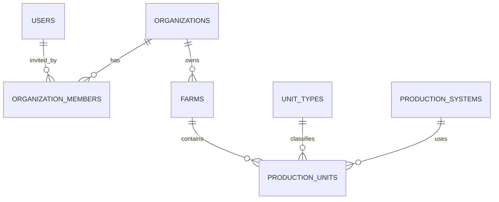
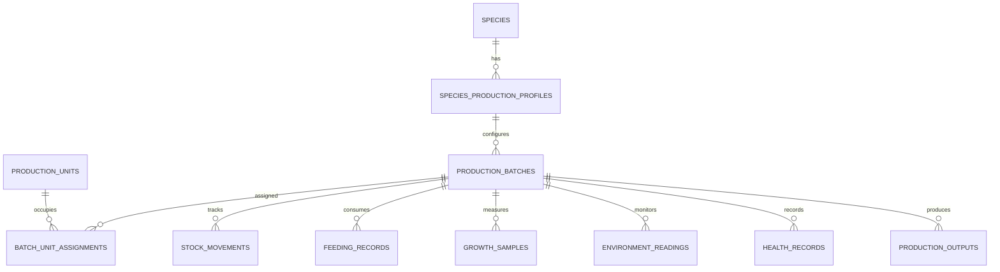
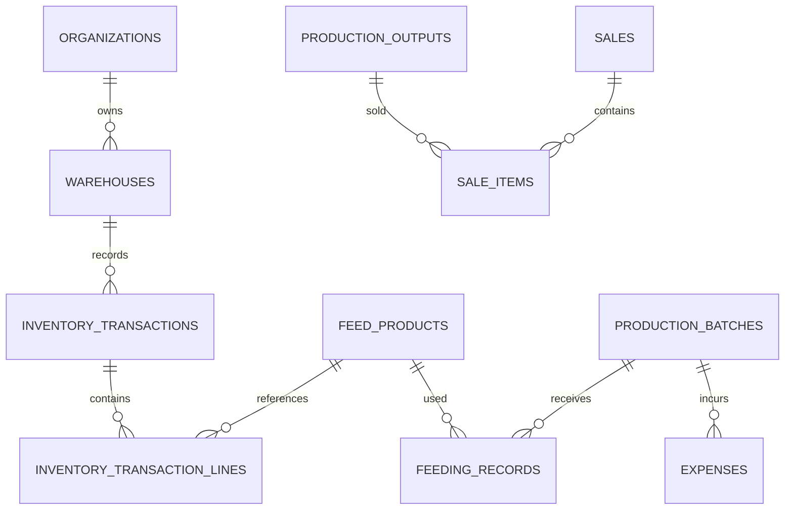
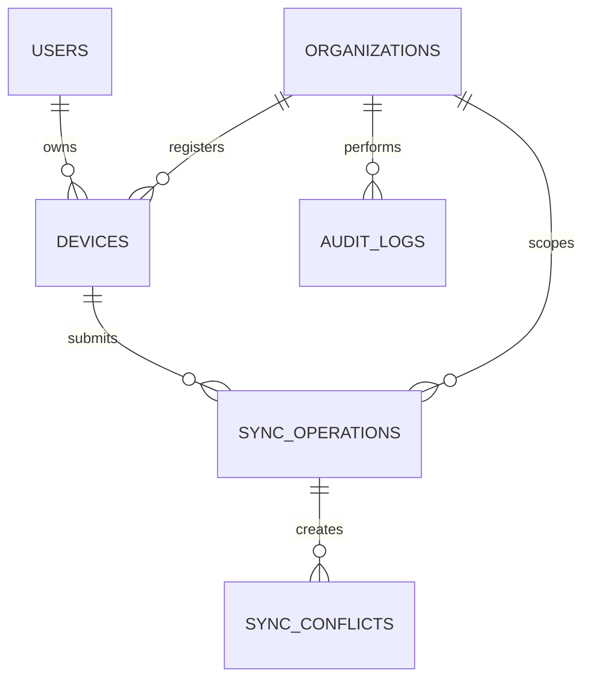
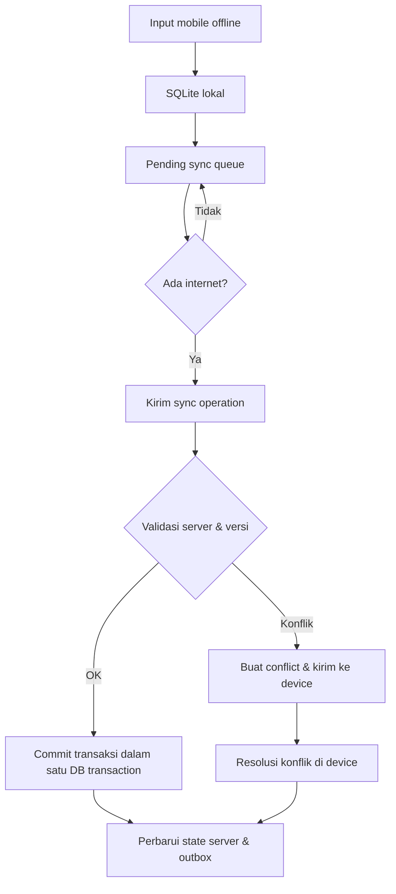

# note-3 — Database Architecture dan Final Data Modeling

> Catatan perjalanan desain. Versi terawat: [../docs/05-DOMAIN-MODEL.md](../docs/05-DOMAIN-MODEL.md). Indeks: [../docs/README.md](../docs/README.md).

Kita lanjutkan TernakMatric ke tahap **Database Architecture & Final Data Modeling**.

Dengan keputusan terbaru, ada empat hal yang akan memengaruhi desain database secara signifikan:

1. **Multiple active batches per unit:** satu unit produksi (kolam, kandang, cage, hive) dapat menampung beberapa batch aktif, sehingga kapasitas harus dihitung berdasarkan total biomassa dan okupansi seluruh batch, bukan per batch saja. Satu batch tetap hanya memiliki satu assignment aktif.
2. **Full inventory management:** stok pakan/ransum harus menggunakan transaksi masuk, keluar, penyesuaian, dan konsumsi yang dapat diaudit.
3. **System + custom species:** master spesies bawaan TernakMatric untuk semua kategori (fish | crustacean | mollusk | poultry | mammal | reptile | insect | other) dapat dipakai semua tenant, sedangkan spesies custom dimiliki organisasi masing-masing.
4. **Full offline synchronization:** setiap transaksi mobile harus bisa dibuat tanpa koneksi, disinkronkan kemudian, dan tidak menyebabkan duplikasi data.

Saya akan menggunakan prinsip berikut:

- PostgreSQL sebagai relational database.
- UUID sebagai primary key.
- `organization_id` sebagai tenant boundary.
- Foreign key komposit untuk menjaga integritas antar-tenant.
- Append-only ledger untuk pergerakan stok dan inventory.
- Versioning untuk parameter produksi per spesies (`species_production_profiles`) dan formula.
- Idempotency untuk transaksi offline.
- Soft delete untuk master data yang perlu dipertahankan histori.

## 1. Final architecture dan keputusan domain

### TernakMatric Database Architecture

Architecture baseline v1.0

**Identity & SaaS**

Users, organizations, members, plans

**Farm & Production Unit Management**

Farms, `unit_types`, `production_systems`, `production_units`

**Animal Production**

Species & `species_production_profiles`, batches, `batch_unit_assignments`, stock movements, growth, `production_outputs`

**Environment**

`environment_metrics` (air, udara, tanah, kandang) dan `environment_readings`

**Inventory**

Warehouse, feed, lots, stock ledger

**Financial**

Expenses, sales, sale items, accounts

**Analytics**

Calculation runs, forecasts, metrics per spesies

**Offline Sync**

Devices, sync operations, conflicts

**Audit & Security**

Audit logs, RLS, permissions

#### Keputusan penting: relasi unit produksi dan batch

Saya memilih relasi:

`ProductionUnit 1:N Batch`

Setiap batch mempunyai satu assignment aktif ke unit produksi pada suatu waktu, tetapi satu unit dapat dipakai bersama oleh banyak batch aktif.

Untuk mendukung pemindahan batch, kita gunakan tabel `batch_unit_assignments` yang menyimpan histori lokasi batch, dengan partial unique index untuk satu assignment aktif per batch.

Contoh (kasus kolam ikan, salah satu kategori):

| Unit  | Batch | Spesies (kategori) | Populasi |
| ----- | ----- | ------------------ | -------- |
| U-001 | B-001 | Lele (fish)        | 1.000    |
| U-001 | B-002 | Nila (fish)        | 500      |
| U-001 | B-003 | Gurame (fish)      | 200      |

Ketiga batch bisa aktif bersamaan. Pola yang sama berlaku untuk kandang unggas (poultry), kandang babi/sapi (mammal), atau rak serangga (insect). Sistem harus memvalidasi total biomassa dan kapasitas unit berdasarkan profil produksi spesies berversi yang digunakan.

## 2. Final ERD

ERD berikut dibagi menjadi beberapa domain agar lebih mudah dipahami dan diimplementasikan.

### A. Tenant, identity, dan farm



### B. Species dan production



### C. Inventory dan financial



### D. Offline synchronization



ERD ini merupakan logical relationship map. Implementasi fisiknya juga akan menggunakan composite foreign keys untuk memastikan relasi tidak menyeberang tenant.

## 3. PostgreSQL schema dan migration

Saya sudah menyiapkan paket database dengan struktur berikut.

**ternakmatric_database_design/**

PostgreSQL database package

Created

**001_ternakmatric_schema.sql**

Tables, constraints, indexes, triggers, RLS

**002_ternakmatric_seed.sql**

Species per kategori, unit types, production systems, plans, formulas (`002_ternakmatric_seed.sql`)

**DATA_DICTIONARY.md**

Fungsi dan penjelasan setiap tabel

**ERD.md**

Hubungan entitas dan domain decisions

**README.md**

Petunjuk instalasi dan catatan implementasi

&#x20;Download database package

Paket ZIP berisi seluruh lima dokumen.

File individual:

- PostgreSQL schema
- Seed data
- Data dictionary
- ERD documentation
- Installation README

## 4. Tenant isolation strategy

Ini bagian yang sangat penting untuk model SaaS.

Contoh:

**Organization A**

Tenant A

- Farm A1
- Production Unit A1 (kolam/kandang)
- Batch A1
- Inventory A1

**Organization B**

Tenant B

- Farm B1
- Production Unit B1 (kolam/kandang)
- Batch B1
- Inventory B1

  **Tenant A tidak boleh mengakses data Tenant B.**

Saya menggunakan dua lapisan proteksi:

1. Composite foreign key untuk menjaga konsistensi relasi antar-tenant.
2. PostgreSQL Row-Level Security untuk membatasi query berdasarkan tenant aktif.

Contoh implementasi pada backend Rust dengan SQLx:

```rust
pub async fn with_organization(
    tx: &mut sqlx::PgConnection,
    org_id: OrganizationId,
) -> Result<(), sqlx::Error> {
    sqlx::query("SELECT set_config('app.current_organization_id', $1, true)")
        .bind(org_id.as_str())
        .execute(tx)
        .await?;
    Ok(())
}
```

Pemanggilan tersebut harus dilakukan dalam transaksi yang sama dengan query tenant. Parameter harus berasal dari membership yang sudah diverifikasi di backend, bukan langsung dipercaya dari request client.

Penting: runtime database user tidak boleh menjadi superuser, table owner, atau mempunyai `BYPASSRLS`.

## 5. Full offline synchronization

Untuk mobile, saya merekomendasikan model **offline-first command synchronization**.

Alurnya:



Setiap transaksi mobile harus memiliki:

| Field                 | Fungsi                               |
| --------------------- | ------------------------------------ |
| `client_operation_id` | Identitas unik transaksi dari device |
| `entity_id`           | UUID entitas                         |
| `operation_type`      | Create, update, delete               |
| `base_version`        | Versi server terakhir yang diketahui |
| `payload`             | Data transaksi                       |
| `status`              | Pending, applied, rejected, conflict |

Ada satu hal yang perlu diperhatikan: stok ternak, inventory, output produksi, dan keuangan tidak boleh menggunakan strategi `client_wins`/last-write-wins secara sembarangan. Konflik wajib melalui jalur resolusi dan koreksi reversal, bukan overwrite.

Misalnya, dua operator offline di lapangan/kandang/kolam mencatat pengeluaran pakan dari gudang yang sama. Ketika keduanya online, server harus memvalidasi ulang saldo, populasi, dan kapasitas unit serta menolak transaksi yang menyebabkan stok negatif.

**Catatan pengembangan:** schema saat ini menyediakan tabel dasar `devices`, `sync_operations`, dan `sync_conflicts`. Implementasi production masih memerlukan server change-feed/cursor, entity versioning, transactional outbox, serta mekanisme resolusi konflik yang lengkap.

## 6. Constraints dan indexes yang perlu diperhatikan

Berikut aturan database yang perlu menjadi invariant sistem.

| Area            | Aturan                                                    |
| --------------- | --------------------------------------------------------- |
| Tenant          | Tidak boleh cross-organization reference                   |
| Production unit | Dimensi, area, dan volume harus valid                      |
| Batch           | `initial_count` harus lebih dari nol                       |
| Stock           | Tidak boleh menghasilkan populasi ternak negatif           |
| Feeding         | Kuantitas pakan harus positif dan unit jelas               |
| Inventory       | Saldo tidak boleh negatif                                  |
| Growth          | Jumlah sampel dan berat harus positif                      |
| Environment     | `metric_value` dan unit harus valid per `metric_id`        |
| Output          | Jumlah panen/telur/susu tidak boleh melebihi stok          |
| Finance         | Nilai transaksi harus non-negatif                          |
| Offline         | Retry tidak boleh menggandakan transaksi                   |

Beberapa aturan tersebut tidak bisa diselesaikan hanya dengan SQL `CHECK`, karena membutuhkan perhitungan lintas baris. Implementasikan menggunakan transaksi database, row locking, dan domain validation.

### Index yang penting

| Index                                         | Tujuan                              |
| --------------------------------------------- | ----------------------------------- |
| `(organization_id, farm_id)`                  | Pencarian unit produksi per farm    |
| `(organization_id, unit_id)`                  | Batch aktif per unit produksi       |
| `(organization_id, batch_id, occurred_at)`    | Histori pergerakan populasi         |
| `(organization_id, batch_id, measured_at)`    | Bacaan lingkungan per batch         |
| `(organization_id, batch_id, sampled_at)`     | Histori pertumbuhan                 |
| `(organization_id, batch_id, fed_at)`         | Histori pakan                       |
| `(organization_id, status)`                   | Dashboard batch                     |
| `(organization_id, status, received_at)`      | Offline sync queue                  |

Sebagian index sudah disediakan dalam migration. Sisanya perlu disesuaikan setelah melihat pola query dan volume data sebenarnya.

## 7. Hal yang wajib diselesaikan sebelum production

Saya tidak akan menyebut migration ini production-ready sebelum beberapa hal berikut diperkuat.

### Database hardening checklist

Belum seluruhnya diterapkan

- Partial unique index untuk satu assignment aktif per batch.
- Composite tenant foreign key untuk seluruh relasi bisnis.
- RLS untuk role dan membership-related tables.
- Immutable ledger dan mekanisme reversal transaksi.
- Inventory balance projection dan rekonsiliasi.
- Transaction-safe capacity validation untuk unit produksi (total biomassa/okupansi semua batch aktif).
- Entity versioning dan sync change-feed.
- Offline conflict resolution.
- Automated migration dan tenant-isolation tests.
- Pengujian idempotency dan concurrency.

Ada pula dua hal yang sengaja belum saya tetapkan:

- Kepadatan/okupansi unit produksi universal untuk semua spesies.
- Feeding rate universal untuk semua fase pertumbuhan.

Nilai tersebut perlu berasal dari `species_production_profiles.parameters` berversi dengan referensi yang dapat dipertanggungjawabkan, divalidasi berdasarkan spesies, sistem produksi, dan kondisi lapangan/kandang/kolam.

## 8. Urutan implementasi berikutnya

Setelah database, saya menyarankan urutan engineering seperti ini:

1. **Database Hardening**

   Finalisasi constraint, RLS, ledger, offline sync, dan migration tests.
2. **Backend Foundation (Rust)**

   Setup project, config, PostgreSQL connection, transaction manager, repository, middleware, dan error handling.
3. **Authentication & Multi-Tenant**

   Register, login, refresh token, organization membership, RBAC, dan tenant context.
4. **Core Animal Production Modules**

   Farm, Production Unit, Species & profiles, Production Batch, Stock Movement.
5. **Calculation Engine**

   Capacity, biomass, survival rate, ABW, weight gain, egg rate, milk yield, FCR, output estimation — semuanya memakai parameter spesies berversi.
6. **Inventory & Finance**

   Warehouse, feed inventory, consumption, expenses, sales of production outputs.
7. **Offline Sync Engine**

   Local persistence, queue, idempotency, server synchronization, conflict resolution.

**Rekomendasi saya:** jangan langsung mengerjakan UI dashboard. Selesaikan dahulu database hardening dan backend foundation. Ini akan menghindari perubahan besar saat modul produksi dan offline synchronization mulai dikembangkan.

Target arsitektur akhirnya:

- Web: Vue 3 SSR + TypeScript (Vite).
- Mobile: React Native + Expo + local SQLite.
- Backend: Rust + Axum; kontrak OpenAPI dari Utoipa di `packages/api-contracts/openapi/ternakmatric.v1.json` (SQLx, bukan SQLC).
- Database: PostgreSQL.
- Communication: REST API dengan parameter path `{id}`.
- Offline synchronization: command queue + version-based conflict resolution; `client_wins` dilarang untuk ledger dan finance.

Dengan fondasi ini, TernakMatric bisa berkembang dari aplikasi pencatatan kolam menjadi platform manajemen produksi ternak yang mendukung banyak organisasi, banyak lokasi, banyak unit produksi (kolam, kandang, cage, hive), serta berbagai spesies: fish, crustacean, mollusk, poultry, mammal, reptile, insect, dan other.
